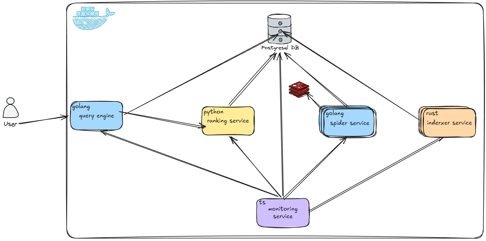

# Boogle - Learning Search Engine

A 2000s-style search engine built for educational purposes.

<div align="center">
  
  
</div>

## Architecture Overview

<div align="center">
  
</div>

## Quick Start

```bash
# 1. Configure every service. Replace all "change-me-*" values with real
#    secrets; the database, Redis and RabbitMQ examples must agree.
cp .env.example .env
cp services/engine/.env.example services/engine/.env
cp services/spider/.env.example services/spider/.env
cp services/indexer/.env.example services/indexer/.env
cp services/ranking/.env.example services/ranking/.env

# 2. Start the shared infrastructure (creates the search_net network and the
#    pgdata volume). Datastores publish on 127.0.0.1 only.
docker compose up -d --build

# 3. Apply migrations. Safe to re-run; required for an existing database
#    because Postgres only runs init scripts on an empty PGDATA.
./scripts/migrate.sh

# 4. Start the four services.
docker compose -f services/spider/docker-compose.yml  up -d --build
docker compose -f services/indexer/docker-compose.yml up -d --build
docker compose -f services/ranking/docker-compose.yml up -d --build
docker compose -f services/engine/docker-compose.yml  up -d --build

# 5. Open the engine
open http://localhost:1323
```

`just run` does steps 1-4 in one go (bootstrap env files, start the
datastores, apply migrations, then build and start all four services).
`just run-logs` follows their output and `just stop` shuts the stack down
without deleting the `pgdata` volume.

## Services

| Service | Language | Purpose |
|---------|----------|---------|
| [Engine](services/engine/) | Go | Web interface, query handling, search results |
| [Spider](services/spider/) | Go | Web crawler, link discovery and frontier management |
| [Indexer](services/indexer/) | Rust | HTML parsing, word extraction, TF calculation |
| [Ranking](services/ranking/) | Python | TF-IDF and PageRank scoring |

## Pipeline

```
Web → Spider (RabbitMQ) → Indexer (RabbitMQ) → Ranking (RabbitMQ) → Engine → User
```

## Requirements

- Docker & Docker Compose V2
- Git

All other dependencies (PostgreSQL, Redis, language runtimes) run inside containers.

## Setup

1. Clone the repo and `cd` into it
2. Copy `.env.example` to `.env` and replace every placeholder secret
3. Copy each `services/<svc>/.env.example` to `services/<svc>/.env` and keep the
   shared values identical (database, Redis and broker credentials)
4. Follow the Quick Start above

To rebuild after changing code:

```bash
docker compose -f services/<svc>/docker-compose.yml up -d --build
```

### Data and teardown

The corpus lives in the `pgdata` Docker volume. `docker compose down` keeps it;
`docker compose down -v` deletes Postgres data permanently. Redis holds only
crawl frontier state, so losing it costs a re-crawl, not the index.

## Docs

- [docs/ARCHITECTURE.md](docs/ARCHITECTURE.md) — end-to-end pipeline, services, data model, messaging
- [Services Overview](services/README.md) — service responsibilities and data flow
- [docs/ENGINE.md](docs/ENGINE.md) — search architecture and templates
- [docs/SPIDER.md](docs/SPIDER.md) — crawling algorithm and database schema
- [docs/INDEXER.md](docs/INDEXER.md) — TF calculation and word extraction
- [docs/RANKING.md](docs/RANKING.md) — PageRank math and IDF scoring


## Development

See individual service READMEs in [services/](services/) for language-specific build commands.

---

**Status**: Learning project — not for production
**License**: MIT
