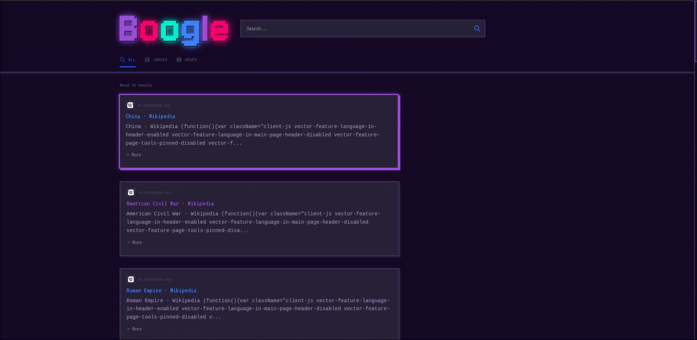

# Boogle — Learning Search Engine

A 2000s-style search engine built for educational purposes.

<div align="center">
  
  
</div>

> **Status:** learning project, not production-ready. There is no authentication,
> no cache, no metrics endpoint, and the engine port is published on all host
> interfaces by the default Compose setup.

## Architecture

Boogle is four services joined by PostgreSQL, RabbitMQ and a Redis crawl frontier.
Services do not call one another directly.

```text
Web → Spider ──indexer.jobs────────→ Indexer ──indexer.confirmations────────→ Ranking
       │                              │                                      │
       │ urls, pages, graph_edges     │ words, page_word                     │ words.idf, page_rank
       └──────────────┬───────────────┴──────────────────┬───────────────────┘
                      ▼                                  ▼
                  PostgreSQL index  ←── reads ── Engine ──→ User
```

- **Spider** (Go) discovers URLs, enforces crawl policy and stores page HTML plus the link graph.
- **Indexer** (Rust) claims pages, tokenizes HTML and writes term frequencies.
- **Ranking** (Python) recomputes IDF and PageRank from confirmation batches.
- **Engine** (Go) serves the templ/HTMX UI and computes `tf * idf` + PageRank scores at query time.

See the [documentation site source](docs/index.md) for the full architecture, contracts and known issues.

## Requirements

For the containerised quick start:

- Docker with Compose V2 (≥ 2.24 for the `env_file: { path, required }` syntax)
- Git
- [`just`](https://github.com/casey/just)
- Python 3 for `scripts/docker-env.sh`

Local development also needs Go 1.27.x, Rust (edition 2024), Python 3.11+ with a
venv, Node 22 for engine assets, templ, and a host `psql` client for integration tests.
See [Prerequisites](docs/getting-started/prerequisites.md).

## Quick start

```bash
# 1. Bootstrap missing .env files and generate container overlays.
#    Replace every change-me-* value; shared credentials must agree.
just env

# 2. Start PostgreSQL, Redis, RabbitMQ and Adminer; wait for readiness.
just infra-up

# 3. Apply migrations (safe to re-run; required for an existing database).
./scripts/migrate.sh

# 4. Build and start all four services.
just run

# 5. Open the engine.
open http://localhost:1323
```

`just run` performs steps 1–4 in one go. `just run-logs` follows all four service
log streams; `just stop` stops the stack without deleting the `pgdata` volume.

Useful local endpoints:

| URL | Purpose |
|-----|---------|
| `http://localhost:1323` | Engine UI |
| `http://127.0.0.1:8080` | Adminer |
| `http://127.0.0.1:15672` | RabbitMQ management UI |

Because the engine is published as `1323:1323`, bind it to loopback or put a
trusted reverse proxy in front of it outside a trusted local network. See
[Known issues](docs/reference/known-issues.md).

## Services

| Service | Source | Language | Purpose |
|---------|--------|----------|---------|
| Engine | [services/engine](services/engine/) | Go | Web UI, query handling, result ranking |
| Spider | [services/spider](services/spider/) | Go | Crawling, policy, frontier, link graph |
| Indexer | [services/indexer](services/indexer/) | Rust | HTML parsing, tokenization, term frequencies |
| Ranking | [services/ranking](services/ranking/) | Python | IDF and PageRank recomputation |

Service-owned technical documentation lives under `services/<service>/docs/`.

## Documentation

The MkDocs + Material site is built from `docs/` and the aggregated service pages.

```bash
just docs-install            # create .venv-docs and install pinned dependencies
just docs-serve              # local live-reloading site at 127.0.0.1:8000
just docs-build              # strict production build into site/
just docs-check              # nav/link validation plus strict build
just docs-service spider     # standalone build for one service (spider|engine|indexer|ranking)
```

Start with:

- [Documentation home](docs/index.md)
- [Getting started](docs/getting-started/quick-start.md)
- [Architecture overview](docs/architecture/overview.md)
- [Data and message contracts](docs/data/message-contracts.md)
- [Operations](docs/operations/docker.md)
- [Known issues](docs/reference/known-issues.md)
- [Documentation workflow](docs/development/documentation.md)

The generated trees `docs/services/`, `docs/assets/`, `site/`, `site-services/`,
`.docs-build/` and `.venv-docs/` are ignored. Edit source pages under
`services/<service>/docs/`, not their generated copies. The
[Docs CI workflow](.github/workflows/docs_ci.yaml) validates nav, links and all
four standalone service builds.

Older mixed-case files such as `docs/ENGINE.md` are historical notes and are not
part of the generated site; the MkDocs tree and service-owned docs are authoritative.

## Data and teardown

The corpus lives in the `pgdata` Docker volume. `docker compose down` or
`just stop` keeps it; `docker compose down -v` deletes Postgres data permanently.
Redis holds crawl-frontier state, so losing it costs a re-crawl, not the index.

## Development

```bash
just test              # fast unit tests, no infrastructure
just test-integration  # requires Postgres; resets boogle_test
just test-all
```

See [Testing](docs/development/testing.md) and the individual service READMEs for
language-specific commands.

---

**Status**: Learning project — not for production
**License**: MIT
