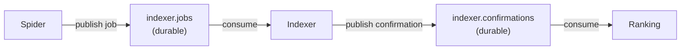

# Communication

**Last updated:** 2026-11-23

The services never call one another directly. All asynchronous handoffs go through RabbitMQ using two durable queues and the **default exchange**. PostgreSQL carries the actual page content; broker messages carry only a page identifier.

Sources of truth: `services/spider/internal/messaging/`, `services/indexer/src/core/messaging.rs`, and `services/ranking/src/messaging.py`.

## Queue topology



| Queue | Producer | Consumer | Declared by | Exchange / routing key |
|---|---|---|---|---|
| `indexer.jobs` | Spider, Indexer sweep | Indexer | Spider and Indexer, durable | default `""` / queue name |
| `indexer.confirmations` | Indexer | Ranking | Indexer and Ranking, durable | default `""` / queue name |

!!! note "One exchange, no routing"
    No custom exchange, topic routing, or dead-letter exchange is declared. The routing key is always the queue name through the default exchange. Both queues are `durable` with default arguments.

Queue names are configuration values (`RABBITMQ_QUEUE`, `RABBITMQ_CONFIRMATION_QUEUE`) that default to `indexer.jobs` and `indexer.confirmations`. They must be kept consistent across services; nothing validates agreement at startup.

## Message contract

Both message types have the same shape and serialize to the same JSON:

```json
{"page_id":"6f8c3c3c-1b1a-4b2e-9f3d-2c4e5f6a7b8c"}
```

| Field | Type | Meaning |
|---|---|---|
| `page_id` | UUID string | The `pages.id` row the message refers to |

- **Spider → Indexer:** the Spider hand-builds the payload from the persisted page UUID and publishes it only after the Postgres transaction commits (`services/spider/internal/messaging/type.go:7-9`, `services/spider/internal/spider/spider.go:399-408`).
- **Indexer → Ranking:** the Indexer serializes `IndexConfirmation { page_id: Uuid }` after the word-index write and before marking the page complete (`services/indexer/src/core/messaging.rs:19-22`, `services/indexer/src/core/indexer.rs:283-288`).

!!! note "Payloads carry identifiers only"
    Consumers load the URL, HTML, and scores from PostgreSQL. The `page_id` is the entire contract; no other field is required.

### Validation differences

- The Indexer schema-deserializes incoming jobs. Extra fields are tolerated, but malformed JSON, a missing or empty `page_id`, and non-UUID values are rejected as poison (`services/indexer/src/core/messaging.rs:77-105`).
- Ranking accepts any dict body, reads `body.get("page_id")` only for logging, and increments its counter regardless of the value's validity (`services/ranking/src/messaging.py:97-104`).

## Publishing semantics

| Publisher | Delivery mode | Confirms | Mandatory | Retries |
|---|---|---|---|---|
| Spider (`indexer.jobs`) | persistent (`delivery_mode=2`) | yes, 5 s confirm timeout, checks `basic.return`/nack | yes | publish failure parks URL 30 s |
| Indexer confirmations (`indexer.confirmations`) | persistent, `content_type=application/json` | yes (`confirm_select`, awaits broker confirmation) | yes | `MAX_RETRIES` (default 3) |
| Indexer sweep republish (`indexer.jobs`) | persistent, JSON content type | **no** | **no** | fixed 3 attempts |

!!! warning "Sweep republish is best effort"
    The stale-claim sweep publishes with plain `basic_publish` — no confirms or mandatory flag — after it has already released the claim and deleted partial `page_word` rows (`services/indexer/src/core/indexer.rs:387-393`, `services/indexer/src/core/psql.rs:95-114`). A lost republish is not automatically detected.

## Consumption and delivery semantics

### Indexer (job consumer)

- AMQP QoS/prefetch is set to `max_concurrent_tasks`, derived from `PG_MAX_CONNECTIONS` (default 10); one Tokio task is spawned per delivery behind a semaphore of the same size (`services/indexer/src/core/indexer.rs:70-79`, `143-147`, `174-186`).
- **ACK** only after `index_page()` succeeds (`indexer.rs:188-196`). ACK failures are logged only.
- **NACK** with `requeue = should_requeue(&err)` on failure (`indexer.rs:197-209`):

| Error class | Requeue? |
|---|---|
| Database errors except `NotFoundError` | yes |
| All messaging errors | yes |
| `Other` | yes |
| `SerdeError`, `ParseError`, `DatabaseError::NotFoundError` | no (dropped) |

- A dropped poison message is not dead-lettered. A parse error also releases the page claim, so the sweep can republish the same page after the grace period — dropping the message is not permanent quarantine (`services/indexer/src/core/indexer.rs:241-256`).
- Consumer stream end/error triggers reconnect with exponential backoff from 1 s to 30 s (`indexer.rs:105-140`).

### Ranking (confirmation consumer)

- FastStream subscriber on a durable `RabbitQueue`; no exchange object and no explicit ack/requeue policy are configured in ranking code (`services/ranking/src/messaging.py:83-104`). FastStream 0.7.7 defaults to `AckPolicy.REJECT_ON_ERROR`.
- Each message calls `record_confirmation()`, incrementing an in-process counter. A background pipeline task starts at the configured threshold (default 100); only `page_id` is used, for logging.
- If a scoring run fails, the confirmation batch stays counted and is retried on the next confirmation; there is no tight retry loop (`services/ranking/src/messaging.py:179-191`).

## Related pages

- [Data flow](data-flow.md) — what each message triggers in the database.
- [Services](services.md) — which service writes which table.
- [Infrastructure](infrastructure.md) — broker ports, credentials, and startup order.
