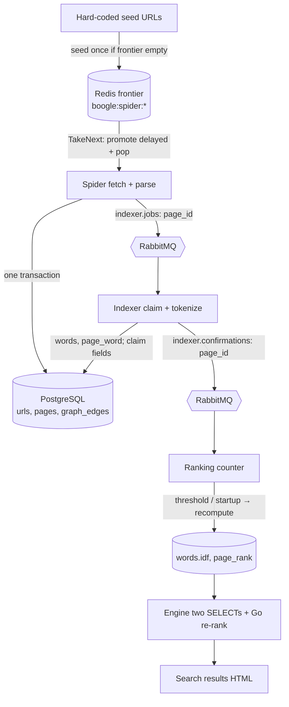

# Data flow

**Last updated:** 2026-11-23

This page follows one page through the whole pipeline: from a seed URL in Redis, through the crawl tables, the inverted index, a confirmation batch, a ranking recompute, and finally a search query in the Engine. Every handoff is a PostgreSQL row or a RabbitMQ message; see [Communication](communication.md) for the wire contract.

Sources of truth: `services/`, `migration/01_schema.sql`, `migration/02_pg_rank.sql`, `migration/03_index_completion.sql`.

## End-to-end flow



## 1. Crawl: seed → Redis frontier → Postgres

1. The Spider's seed list is **hard-coded** in `services/spider/cmd/spider/main.go:27-43`; it is not configurable by env. `store.Init` pushes the seeds into the Redis frontier only when that frontier is empty, so a restart does not re-inject them (`services/spider/internal/store/store.go:105-123`).
2. Each crawler calls `policy.TakeNext`, which promotes due delayed URLs and **destructively pops** a URL from the sorted-set frontier (`services/spider/internal/policy/crawl.go:21-48`). Post-pop failures are handled by explicit `requeue` into the delayed set, not by a visibility timeout.
3. The URL is canonicalized, admitted by robots/host policy, fetched through a public-only HTTP client, classified, and parsed for links and text (`services/spider/internal/spider/spider.go:227-420`).
4. `store.Persist` writes the URL, the page (`html`, `metadata`), and discovered `graph_edges` in **one transaction** (`services/spider/internal/store/store.go:66-97`). New pages default to `indexed = FALSE`.
5. Only after that commit does the Spider publish `indexer.jobs` with the page UUID. A publish failure parks the URL for 30 seconds for retry (`spider.go:399-408`).

Redis holds the frontier, delayed/visited sets, and per-URL/per-host policy state under the `boogle:spider:*` prefix in DB 1. It has no persistence volume, so a Redis restart loses crawl state even though the crawled pages remain in Postgres (`docker-compose.yml:25-41`).

!!! warning "X-01 — re-crawl does not re-index"
    The Spider upsert is `INSERT ... ON CONFLICT (url_id) DO UPDATE SET metadata = EXCLUDED.metadata` (`services/spider/internal/store/db.go:109-111`). It does **not** replace `html` and does **not** reset `indexed`/`indexed_at`. A re-crawl job for an already-indexed page therefore fails the Indexer's `indexed = FALSE` claim guard (`services/indexer/src/core/psql.rs:150`) and is dropped as `NotFoundError`. Changed content is never re-indexed.

## 2. Index: job → claim → words/page_word

```sql
-- claim (one statement): indexed = TRUE means CLAIMED, not finished
WITH cte AS (
  SELECT id, url_id, html FROM pages
  WHERE indexed = FALSE AND id = $1 AND index_attempts < $2
  FOR UPDATE SKIP LOCKED LIMIT 1
)
UPDATE pages SET indexed = TRUE, indexed_at = NULL,
                 last_index_attempt_at = NOW(),
                 index_attempts = pages.index_attempts + 1
FROM cte WHERE pages.id = cte.id
RETURNING pages.id, pages.url_id, pages.html;
```

- `FOR UPDATE SKIP LOCKED` lets multiple Indexer replicas take distinct rows. `index_attempts` counts every delivery, including a crashed one. See `services/indexer/src/core/psql.rs:144-177`.
- HTML is parsed in `spawn_blocking`; `script`/`style` text is skipped, tokens are lowercased, punctuation-trimmed, and must be alphabetic. Tokens longer than 25 characters are dropped to fit `words.word VARCHAR(25)`. Unicode letters are accepted (`services/indexer/src/core/text_sink.rs:55-74`, `166-179`, `337-342`).
- One transaction deletes the page's old `page_word` rows, upserts `words` (word text only), and inserts `(page_id, word_id, tf)`. **`tf` is a raw integer count**, not a normalized ratio (`services/indexer/src/core/psql.rs:182-276`, `482-499`).
- The Indexer does not write `words.idf` or `words.doc_frequency`; those stay at schema defaults until Ranking runs.

### Claim state machine

| State | `indexed` | `indexed_at` | Meaning |
|---|---|---|---|
| Unindexed | `FALSE` | `NULL` | Eligible for a claim |
| Open claim | `TRUE` | `NULL` | Claimed, work in progress |
| Complete | `TRUE` | non-`NULL` | Indexed and confirmed |

`indexed = TRUE` alone means **claimed**, not complete. Completion is exactly `indexed_at IS NOT NULL` (`migration/03_index_completion.sql:1-10`, `services/indexer/src/core/psql.rs:58-85`).

On success the Indexer publishes the confirmation **before** `mark_indexed` (which sets `indexed_at = NOW()`, clears `last_index_attempt_at`, and resets `index_attempts = 0`), then ACKs the job. On failure it calls `release_claim()`/`undo_indexing()`, which clears the open claim and deletes the page's `page_word` rows only while `indexed_at IS NULL` (`indexer.rs:91-103`, `241-327`; `psql.rs:278-316`). A stale-claim sweep reclaims open claims older than the grace period and republishes stale unindexed pages on a best-effort basis (`indexer.rs:357-402`).

## 3. Rank: confirmations → IDF and PageRank

Ranking counts confirmations in memory and starts a full recompute at a threshold (default `100`) or once at startup (`RANKING_RUN_ON_STARTUP`, default true). There is no timer (`services/ranking/src/messaging.py:12`, `120-191`; `src/main.py:144-149`).

| Score | Statement | Corpus | Details |
|---|---|---|---|
| IDF | one `UPDATE ... FROM doc_freq` (`calculator.py:11-28`) | **all** `pages` (`GREATEST(COUNT(*),1)`) | `log10(n / GREATEST(df,1))`; writes `words.idf` only; `page_word.tf` unused; `words.doc_frequency` not maintained |
| PageRank | `SELECT update_page_rank(%s,%s)` (`calculator.py:30-32`) | only `pages WHERE indexed = TRUE` | 20 iterations, damping 0.85, `graph_edges` restricted to indexed → indexed, dangling mass redistributed; deletes stale then upserts `page_rank` (`migration/02_pg_rank.sql`) |

The two statements run concurrently in an `asyncio.TaskGroup` but **commit independently** — the pair is not atomic (`services/ranking/src/calculator.py:102-118`). A failed batch stays pending until the next confirmation.

!!! warning "X-02 — three different corpus definitions"
    IDF uses **all** pages (`services/ranking/src/calculator.py:12-15`), PageRank uses only rows with `indexed = TRUE` — which means *claimed*, not necessarily complete (`migration/02_pg_rank.sql:14-18`) — and the Engine applies no `indexed` filter in either query (`services/engine/internal/store/store.go:83-114`, `209-214`). A single blended result score therefore combines three different page populations.

## 4. Query: Postgres → Engine → browser

`GET /search?query=...` executes two parameterized SELECTs: a count of matching `page_word` rows and a candidate window (default 100) joined to `pages`, `urls`, `words.idf`, and `page_rank` via `LEFT JOIN` (missing ranks become score `0`) (`services/engine/internal/store/store.go:83-114`, `209-214`). The Engine never queries `graph_edges` and writes no tables.

In Go, each candidate gets a TF-IDF vector (`tf * idf` per matched word); the ranker computes cosine similarity against the query vector, min–max normalizes those scores across the candidate window, then blends with the raw PageRank score as `factor * normalizedTFIDF + (1 - factor) * PRScore`, where `factor = RANKER_WEIGHT_TF` (default `0.5`) (`services/engine/internal/service/ranking/`). Results are ordered and paginated with `PAGE_SIZE` (default 20). PageRank is **not** normalized by the Engine, and unranked pages get `COALESCE(pr.score, 0)`, placing them last on that signal while remaining searchable. The two SELECTs are not in a transaction, so a concurrent write can make the count and candidate window disagree. A spellchecker suggests corrections for low-result queries; its fallback speller degrades multi-word queries. Results render as a full HTML page or an htmx fragment.

## Ownership summary

| Artifact | Written by | Read by |
|---|---|---|
| Redis frontier and policy state | Spider | Spider |
| `urls`, `pages.html`, `pages.metadata`, `graph_edges` | Spider | Indexer, Ranking, Engine |
| `pages` claim/completion fields | Indexer | Ranking (`indexed`), Indexer |
| `words` (text), `page_word` (`tf`) | Indexer | Ranking (no `tf`), Engine (`tf`) |
| `words.idf`, `page_rank` | Ranking | Engine |
| RabbitMQ messages | Spider, Indexer | Indexer, Ranking |

See [Services](services.md) for entry points and [System design](system-design.md) for the structural rules.
