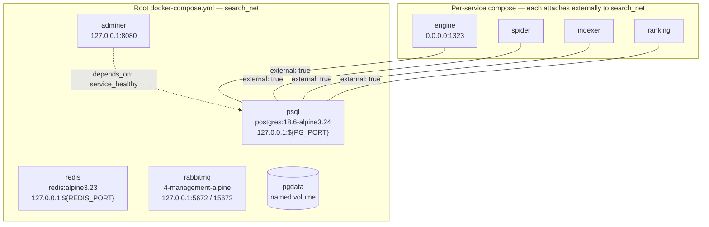

# Infrastructure

**Last updated:** 2026-11-23

Boogle runs as five root containers (four datastores/tools plus four separately built service images attached over one network). This page describes the container topology, network and volume, published ports, startup order, healthchecks, and build-time assets. All content is verified from `docker-compose.yml`, the four `services/*/docker-compose.yml` files, the `Dockerfile`s/entrypoints, and the root `justfile`.

## Container topology



Two compose layers coexist:

| Layer | File | Contents |
|---|---|---|
| Root stack | `docker-compose.yml` | `psql`, `redis`, `rabbitmq`, `adminer`; defines `search_net` and the `pgdata` volume |
| Per-service | `services/<svc>/docker-compose.yml` | one service each: `engine`, `spider`, `indexer`, `ranking`; builds locally from that service's `Dockerfile` |

!!! note "One network, external by name"
    The root compose declares `search_net` with `name: search_net`, and every per-service compose attaches to it with `external: true`. This lets the services be started separately while still reaching the datastores by container name (`psql`, `redis`, `rabbitmq`).

## Network and storage

- **`search_net`** — a single bridge network shared by all containers; declared with a fixed name so per-service composes can attach externally (`docker-compose.yml:76-80`).
- **`pgdata`** — the only named volume, mounted at `/var/lib/postgresql` (the **parent** of the usual data directory) (`docker-compose.yml:6-8`, `:73-74`). Migrations are bind-mounted into `/docker-entrypoint-initdb.d` for first boot; `scripts/migrate.sh` re-applies them explicitly on later boots because Postgres runs init scripts only into an empty `PGDATA`.
- **No Redis volume and no `appendonly` command** — a Redis restart loses the crawl frontier and policy state.
- **No logging config, resource limits, `deploy:` blocks, or TLS** anywhere; Docker's default log driver applies.

## Published ports

| Port | Service | Bind |
|---|---|---|
| `${PG_PORT}` → 5432 | psql | `127.0.0.1` only |
| `${REDIS_PORT}` → 6379 | redis | `127.0.0.1` only |
| 5672 / 15672 | rabbitmq AMQP / management UI | `127.0.0.1` only |
| 8080 | adminer | `127.0.0.1` only |
| **1323** | **engine** | **all host interfaces** (`1323:1323`) |

!!! warning "Engine is the only externally reachable service"
    All datastores and UIs are loopback-bound, but the Engine publishes `1323` on every host interface. Its routes have no authentication; only an in-process Echo rate limiter and the public-only crawler dialer (a different service) constrain traffic. See [System design](system-design.md) and [Known issues](../reference/known-issues.md).

The `just run` preflight aborts if host port 1323 is in use and no `engine` container is running, so a locally running engine/air process must be stopped first (`justfile:63-69`).

## Startup order

`just run` orchestrates the whole stack in this order (`justfile:79-91`):

```text
just run
  → env        bootstrap missing .env files, generate .env.docker overlays
  → preflight  abort if host port 1323 is occupied
  → infra-up   start psql/redis/rabbitmq/adminer; wait for psql and rabbitmq readiness
  → migrate    apply migration/*.sql via docker compose exec
  → services   docker compose up -d --build, in order:
               engine → spider → indexer → ranking
```

- The only readiness gates are the `infra-up` wait loops for **psql and RabbitMQ**. Redis is never waited on, and migration completion is only "the script exited".
- **No per-service `depends_on` against any datastore** exists. The service composes rely on the root-level waits and on each service's own startup retry/fail-fast behavior.
- The only `depends_on` in either layer is `adminer → psql: service_healthy` (`docker-compose.yml:69-71`).
- Container `restart` policy is `unless-stopped` everywhere. `just stop` brings down the service composes and then the root stack; `pgdata` is retained.

## Environment wiring

`just env` copies missing `.env.example` files to `.env` and runs `scripts/docker-env.sh`, which generates `.env.docker` overlays for each service with container-network hosts (`PG_HOST=psql`, `REDIS_ADDR=redis`, `RABBITMQ_HOST=rabbitmq`, and URL-form `DATABASE_URL`/`RABBITMQ_URL`). Compose loads `.env` first, then `.env.docker`; the overlay wins for overlapping keys (`services/*/docker-compose.yml:6-12`).

- `docker-env.sh` hard-requires five root variables: `PG_USER`, `PG_PASSWORD`, `PG_DBNAME`, `RABBITMQ_DEFAULT_USER`, `RABBITMQ_DEFAULT_PASS`, and needs `python3` for URL-encoding credentials.
- Templates use `change-me-*` placeholders, not real secrets. Generated `.env`, `.env.docker`, and logs are gitignored.
- Env naming differs between examples (`RABBITMQ_DEFAULT_*` at root vs `RABBITMQ_*` in service examples); the generator bridges the two.

!!! warning "Generated overlays in the build context"
    `.dockerignore` excludes `**/.env` but not `**/.env.docker`, while each service Dockerfile runs `COPY . .` in a builder stage. Locally generated credential overlays can therefore enter builder layers. Final runtime stages copy only compiled artifacts, so published images do not directly contain them.

## Healthchecks and observability

| Container / image | Check | What it verifies |
|---|---|---|
| psql (compose) | `pg_isready` | database accepts connections |
| redis (compose) | `redis-cli ... ping` | server responds |
| rabbitmq (compose) | `rabbitmq-diagnostics -q ping` | node responds |
| adminer | none | — |
| engine (image) | `wget --spider http://localhost:1323/health` | HTTP `/health` returns OK |
| spider / indexer / ranking (image) | `pidof <binary>` | process is alive **only** |

!!! warning "Process checks are not readiness checks"
    The three `pidof` healthchecks verify only that the binary is running — not that its PostgreSQL, Redis, or RabbitMQ connections are healthy. `GET /health` on the Engine is a static `{"status":"ok"}` JSON response; there is no `/metrics` route, no Prometheus/Grafana container, and no metrics exporter.

Logs: Spider and Indexer write JSON files inside their containers (not bind-mounted, so they disappear with container removal); Ranking writes JSON to stdout with an optional file sink; Engine logs requests to stdout via Echo middleware.

## Build-time assets

The Engine's `public/` directory (Tailwind CSS + esbuild JavaScript) is **generated build output**, produced in the Docker builder stage and copied into the runtime image (`/app/public`); it is gitignored and served from disk at request time. `templ` views are generated during build as well. The other three services have no static assets.

## CI/CD summary

| Workflow type | Trigger | Behavior |
|---|---|---|
| `*_ci.yaml` (four services) | PR to `main`/`dev` touching that service | language test/build/vet (Go, `cargo test`, pytest with 80% gate) |
| `infra_ci.yaml` | PR touching compose/Dockerfile/scripts/migrations | `docker compose config -q` validation + `shellcheck` |
| `*_cd.yaml` (four services) | tag `<svc>@v*` | build and push image to `ghcr.io/<repo>/<svc>`; **no deploy job, tests, or signing** |

No workflow validates documentation, compose startup, or image builds with tests. See the [Documentation guide](../development/documentation.md) for how the docs site is built.
