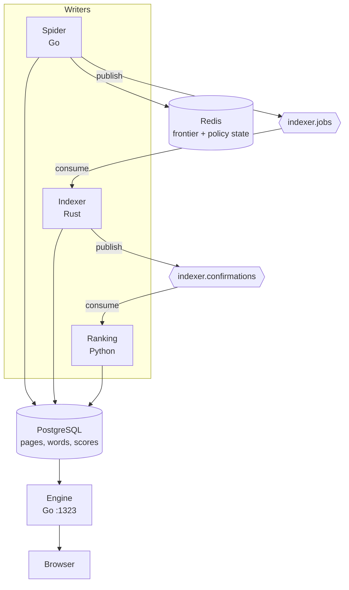

# Architecture overview

**Last updated:** 2026-11-23

Boogle is four independently built services around shared state. There are no direct service-to-service calls: every handoff is either a row in PostgreSQL or a message in RabbitMQ. Redis is private to the Spider.

Sources of truth for this section are `services/`, `migration/`, `docker-compose.yml`, and `justfile`. The historical root-level architecture document is excluded from the site.

## Component map

| Component | Role | Owns | Implementation |
|---|---|---|---|
| Spider | Discover and persist public web pages and links | Redis frontier and crawl-state; `urls`, `pages`, `graph_edges` writes | [Spider service](../services/spider/index.md) |
| Indexer | Turn stored HTML into term frequencies | `words`, `page_word`; page claim/completion fields | [Indexer service](../services/indexer/index.md) |
| Ranking | Maintain IDF and PageRank scores | `words.idf`, `page_rank` | [Ranking service](../services/ranking/index.md) |
| Engine | Serve the search UI over the finished index | Nothing in the database; `public/` assets on disk | [Engine service](../services/engine/index.md) |
| PostgreSQL | Shared corpus and scores | All six base tables | `migration/01_schema.sql` |
| RabbitMQ | Two durable queues with the default exchange | `indexer.jobs`, `indexer.confirmations` | [Communication](communication.md) |
| Redis | Crawl scheduling and admission state | `boogle:spider:*` keys in DB 1 | [Spider configuration](../services/spider/configuration.md) |

## Boundaries and coupling

- **No synchronous service calls.** The Engine never calls the Indexer or Ranking; the Spider never calls the Indexer. RabbitMQ carries page identifiers, and PostgreSQL carries the documents and scores.
- **One write owner per table group.** Spider writes crawl tables, Indexer writes the inverted index and claim fields, Ranking writes scores, Engine reads only. This is summarized in [Services](services.md) and detailed in [Data flow](data-flow.md).
- **Broker payloads carry identifiers only.** Both queue messages are `{"page_id":"<uuid>"}`; consumers load everything else from PostgreSQL. See [Communication](communication.md).
- **Shared schemas are the integration contract.** A change to `pages.indexed`, `indexed_at`, or the queue names affects several services at once. Two such seams are already known gaps: re-crawl state (X-01) and differing corpus definitions (X-02), both described in [Services](services.md).

!!! note "What this design does not include"
    There is no authentication or session handling, no search-result cache, no `/metrics` endpoint or tracing, no monitoring service, and no wall-clock ranking scheduler. The Engine has an in-process Echo rate limiter only. These are absences in the current code, not planned features documented here.

## Consistency model

- Crawler persistence and job publication are sequential, not atomic: the job is published only after the Postgres transaction commits; a publish failure parks the URL for 30 seconds for retry ([Spider implementation](../services/spider/implementation.md)).
- Indexing is at-least-once. The claim uses `FOR UPDATE SKIP LOCKED`; successful work is ACKed, failed work is NACKed with requeue decided by error class ([Indexing pipeline](../services/indexer/indexing-pipeline.md)).
- Ranking runs two independent SQL statements in a `TaskGroup`; they commit separately, so the pair is concurrent but not atomic ([Ranking algorithms](../services/ranking/algorithms.md)).
- The Engine's two SELECTs are also not wrapped in a transaction, so a concurrent write can make the count and candidate window disagree ([Engine implementation](../services/engine/implementation.md)).

## Read next

- [System design](system-design.md) — the structural rules and deliberate absences.
- [Services](services.md) — per-service ownership and entry points.
- [Communication](communication.md) — queue topology and delivery semantics.
- [Data flow](data-flow.md) — one page's full lifecycle.
- [Infrastructure](infrastructure.md) — containers, networks, volumes, and startup order.
