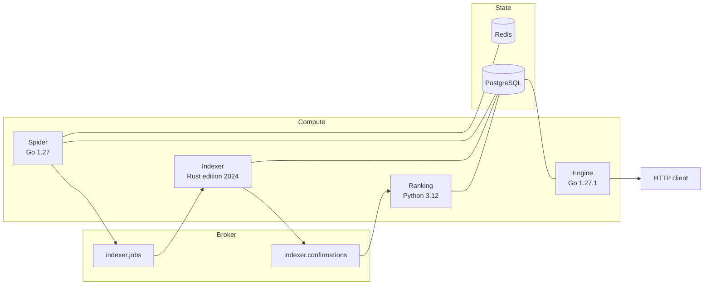

# System design

**Last updated:** 2026-11-23

This page describes the structural rules of the implemented system: four services, one shared PostgreSQL database, two RabbitMQ queues, and one Redis frontier. For the step-by-step lifecycle of a page, see [Data flow](data-flow.md).

## Shape of the system

The four services are separate processes, built from separate repositories directories with separate runtimes and separate Docker images:

| Service | Runtime | Trigger | Primary output |
|---|---|---|---|
| Spider (`services/spider/cmd/spider/main.go`) | Go 1.27 | Ticker-driven crawler goroutines | Pages, links, and indexer jobs |
| Indexer (`services/indexer/src/main.rs`) | Rust edition 2024, Tokio | RabbitMQ job deliveries | Term frequencies and confirmations |
| Ranking (`services/ranking/src/main.py`) | Python 3.11+ (`asyncio`, FastStream) | Startup run + confirmation threshold | `words.idf`, `page_rank` |
| Engine (`services/engine/cmd/server/main.go`) | Go 1.27.1, Echo v5 | HTTP requests | HTML pages and htmx fragments |

## Shared state, not shared code

There is no cross-service import, RPC, HTTP callback, or shared library. Each service has its own datastore client and its own schema view:

| Store | Writer(s) | Reader(s) |
|---|---|---|
| Redis (`boogle:spider:*`, DB 1) | Spider only | Spider only |
| `urls`, `pages.html`, `pages.metadata`, `graph_edges` | Spider | Indexer, Ranking, Engine |
| `pages.indexed`, `indexed_at`, `index_attempts`, `last_index_attempt_at` | Indexer | Ranking (reads `indexed`) |
| `words`, `page_word` | Indexer (`words.idf` later written by Ranking) | Ranking, Engine |
| `page_rank` | Ranking | Engine |
| `public/` assets | Engine build (Tailwind + esbuild) | Engine HTTP server at request time |

!!! warning "Two RabbitMQ queues, one exchange"
    Both queues are declared durable and published to through the **default exchange** with the queue name as routing key. There is no custom exchange, dead-letter exchange, or topic routing. See [Communication](communication.md).

## Coordination patterns

1. **Work queues decouple crawl from index.** The Spider publishes a `page_id` after its Postgres commit; the Indexer claims and processes it independently. Delay, backpressure, and retries live in the broker and in the Indexer's claim/sweep logic.
2. **Database claims replace a coordinator.** `indexed = TRUE` with `indexed_at IS NULL` is an open claim. `FOR UPDATE SKIP LOCKED` lets multiple Indexer replicas take distinct rows. A stale-claim sweep reclaims pages that died mid-index. Completion is `indexed_at IS NOT NULL`.
3. **Confirmations gate ranking.** Ranking counts `indexer.confirmations` and starts a full recompute at a threshold (default 100), with a forced startup pass so a small corpus is searchable. There is no timer-based recompute.
4. **Read-time ranking in the Engine.** Coarse SQL ordering only selects a candidate window (default 100); the final TF-IDF/PageRank blend and pagination happen in Go.

!!! note "No distributed transactions"
    Persistence → publish, confirmation → completion, and IDF → PageRank are separate operations with independent commits. Failures are handled by requeue, claims, and sweeps rather than rollback across components.

## Failure posture

- **Spider:** missing Redis, RabbitMQ, or PostgreSQL is fatal at construction. Fetch and policy failures are classified and retried or parked; publish failure parks the URL for 30 seconds.
- **Indexer:** startup DB/broker failures are fatal. Per-job failures NACK with requeue based on error class; poison parse/serde/not-found jobs are dropped without requeue. A sweep republishes stale unindexed pages on a best-effort basis.
- **Ranking:** startup DB connection retries five times with capped backoff; a failed scoring batch stays pending until another confirmation. `RANKING_RUN_ON_STARTUP` can be disabled.
- **Engine:** startup fails fast if PostgreSQL cannot be reached; request-time store errors become HTML error pages. The single aspell instance is mutex-guarded, and the fallback speller degrades multi-word search.

Details and source references are on each service page: [Spider](../services/spider/index.md), [Indexer](../services/indexer/index.md), [Ranking](../services/ranking/index.md), [Engine](../services/engine/index.md).

## Deliberate absences

| Absence | Consequence |
|---|---|
| No authentication or sessions | Every HTTP route is public; the Engine has only an in-process rate limiter |
| No result cache | Every `GET /search` executes two PostgreSQL queries and re-ranks the whole candidate window |
| No metrics, tracing, or monitoring service | `/health` is a static JSON probe; three service healthchecks are `pidof` only |
| No wall-clock scheduler | Ranking changes only on startup or confirmation threshold |
| No dead-letter exchange | Dropped poison jobs are not retained for inspection |
| No TLS | All published ports are plain HTTP/TCP |

!!! warning "Not a production design"
    Loopback datastore bindings, placeholder credentials, process-only healthchecks, and unvalidated configuration limits place this stack in the learning-project category. See [Infrastructure](infrastructure.md) and [Known issues](../reference/known-issues.md).
