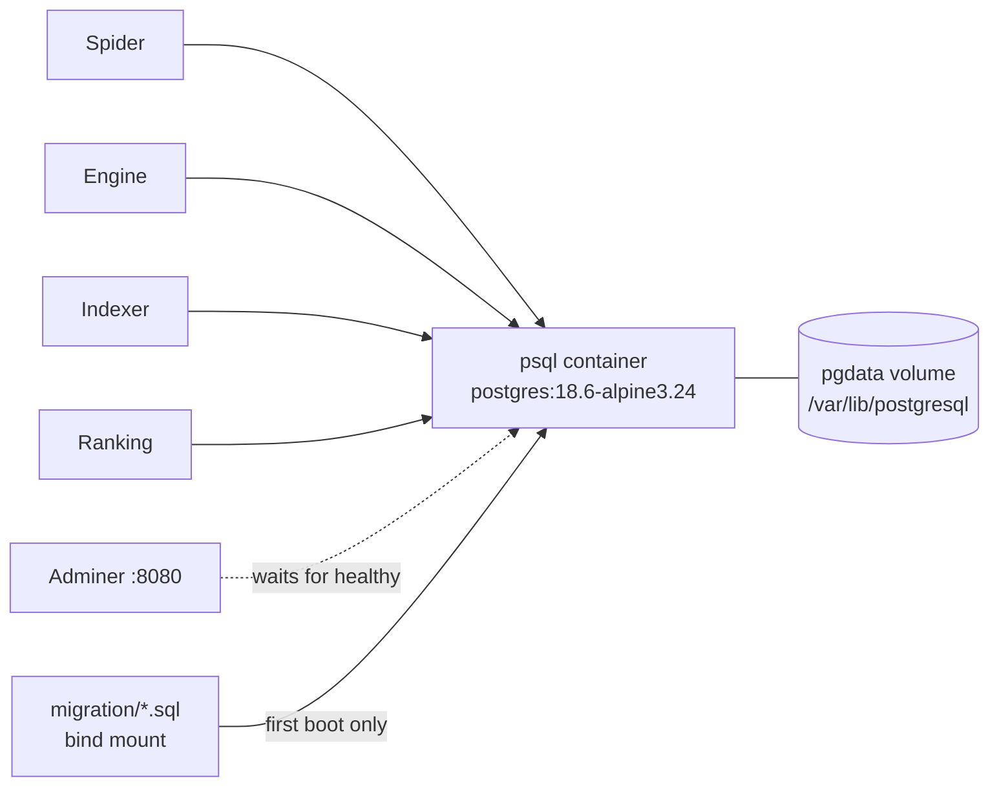

# Database Overview

Boogle keeps all persistent search state in **one shared PostgreSQL instance**:
crawled URLs and HTML, the inverted index, the link graph, and PageRank scores.
All four services connect to the same database and the same schema. There is no
per-service database or schema split; ownership is expressed only by which
tables each service writes (see [Schema](schema.md)).

**Last verified:** 2026-11-23 against migration SQL, `docker-compose.yml`, and
service source. No live database was queried for this documentation.

## Deployment topology

All services attach to the fixed-name Docker network `search_net`. The database
port is published on the host loopback interface only.

| Aspect | Implemented value | Source |
|---|---|---|
| Image / container | `postgres:18.6-alpine3.24`, `container_name: psql`, `restart: unless-stopped` | `docker-compose.yml:2-5` |
| Published port | `127.0.0.1:${PG_PORT}:5432` (loopback only) | `docker-compose.yml:13-16` |
| Data volume | named volume `pgdata` mounted at **`/var/lib/postgresql`** (the parent directory, not `/var/lib/postgresql/data`) | `docker-compose.yml:8`, `:73-74` |
| Init SQL | `./migration` bind-mounted to `/docker-entrypoint-initdb.d` | `docker-compose.yml:7` |
| Credentials / DB | `POSTGRES_USER=${PG_USER}`, `POSTGRES_PASSWORD=${PG_PASSWORD}`, `POSTGRES_DB=${PG_DBNAME}` | `docker-compose.yml:9-12` |
| Healthcheck | `pg_isready -U $${POSTGRES_USER} -d $${POSTGRES_DB}`; interval 5 s, timeout 5 s, 10 retries | `docker-compose.yml:19-23` |
| Admin UI | `adminer:5` on `127.0.0.1:8080`, `depends_on: psql` with `condition: service_healthy` | `docker-compose.yml:61-71` |

!!! warning "Init SQL runs only on an empty data directory"
    PostgreSQL executes `/docker-entrypoint-initdb.d` only on first boot. Later
    schema changes are applied explicitly by [`scripts/migrate.sh`](migrations.md).

!!! warning "`pgdata` is the corpus"
    It is the only named volume in the stack. `docker compose down -v` deletes
    the indexed corpus; no backup job is configured. `docker compose down`
    without `-v` preserves it.

## Connection surface

The example root `.env` ships `PG_HOST=psql`, `PG_PORT=5432`, `PG_USER=admin`,
`PG_PASSWORD=<placeholder>`, `PG_DBNAME=se`. Container overlays are generated by
`scripts/docker-env.sh` and override per-service values for overlapping keys.
See [Environment variables](../reference/environment-variables.md) for the full
list.

| Service | Connection env | DSN construction | Pool / timeout behavior | Source |
|---|---|---|---|---|
| [Spider](../services/spider/index.md) | five `PG_*` values | libpq key/value DSN with `sslmode=disable`; password revealed only to the driver, never logged | `PG_MAX_OPEN_CONNS=20`, `PG_MAX_IDLE_CONNS=20`, `PG_MAX_CONN_LIFETIME=0` | `services/spider/internal/store/db.go:22-35`, `:48-50` |
| [Engine](../services/engine/index.md) | five `PG_*` values (+ optional `PG_SSLMODE`, default `disable`) | libpq URL built by `connectionString` | config in `services/engine/internal/config/store/store.config.go:14-31` | `services/engine/internal/store/store.go:233` |
| [Indexer](../services/indexer/index.md) | `DATABASE_URL` (required) | sqlx options with `application_name=boogle-indexer`, `lock_timeout`, `statement_timeout`, fixed `idle_in_transaction_session_timeout=30000` ms | `PG_MAX_CONNECTIONS=10`, `PG_MIN_CONNECTIONS=2`, `ACQUIRE_TIMEOUT_SECONDS=5` | `services/indexer/src/core/psql.rs:324-340` |
| [Ranking](../services/ranking/index.md) | `DATABASE_URL` preferred; otherwise all five `PG_*` | `psycopg.conninfo.make_conninfo`; missing values fail closed | min 2 / max 10, opened eagerly with `wait=True` | `services/ranking/src/psql.py:62-109` |

In containers, `scripts/docker-env.sh` writes `PG_HOST=psql` / `PG_PORT=5432`
for Engine, Spider and Ranking, and a single percent-encoded `DATABASE_URL` for
Indexer (`scripts/docker-env.sh:33-41`, `:43-80`).

## Data ownership

One database, no split by service. Each service writes only its own paths:

| Table | Written by | Read by |
|---|---|---|
| `urls` | Spider | Engine, Indexer, Ranking |
| `pages` | Spider (rows), Indexer (claim/completion fields) | Engine, Indexer, Ranking |
| `words` | Indexer (rows), Ranking (`idf`) | Engine, Ranking, Indexer |
| `page_word` | Indexer | Engine, Ranking |
| `graph_edges` | Spider | Ranking |
| `page_rank` | Ranking | Engine |

This table is a summary; exact constraints, indexes and column semantics are in
[Schema](schema.md).

## Operational notes

- The healthcheck verifies only that the server accepts connections, not that
  migrations are current or that any table has data.
- No service-level compose file declares `depends_on` against `psql`; startup
  gating is done by the root `justfile` wait loops, not by Compose.
- All timestamps are `TIMESTAMP` **without time zone** (`migration/01_schema.sql`).
- The `pgcrypto` extension supplies `gen_random_uuid()` for server-side IDs
  (`migration/01_schema.sql:3`).

## Related pages

- [Schema](schema.md)
- [Migrations](migrations.md)
- [Message contracts](message-contracts.md)
- [Architecture: infrastructure](../architecture/infrastructure.md)
