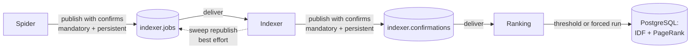

# Message Contracts

Spider, Indexer and Ranking communicate through two durable RabbitMQ queues on
the default exchange. Both payloads are small JSON objects containing a single
page UUID. Queue names are environment-overridable; keep them consistent across
services.

**Last verified:** 2026-11-23 from service source. No live broker was queried.

## Queue topology



| Queue | Default name | Config key | Declared by | Consumer |
|---|---|---|---|---|
| Jobs | `indexer.jobs` | Spider: `RABBITMQ_QUEUE` > `RABBITMQ_JOB_QUEUE` > default; Indexer: `RABBITMQ_QUEUE` | Spider declares it durable (`services/spider/internal/messaging/rabbitmq.go:174-188`); Indexer also declares both queues durable at startup (`services/indexer/src/core/messaging.rs:167-183`) | Indexer |
| Confirmations | `indexer.confirmations` | `RABBITMQ_CONFIRMATION_QUEUE` in both Indexer and Ranking | Indexer declares durable; Ranking declares a durable consumer queue (`services/ranking/src/messaging.py:83-88`) | Ranking |

No custom exchange is declared by any service. Publishing uses the default
exchange `""` with the **queue name as the routing key**
(`services/spider/internal/messaging/rabbitmq.go:88-135`,
`services/indexer/src/core/messaging.rs:227-264`).

## Wire contracts

```json
// Spider to indexer.jobs — services/spider/internal/messaging/type.go:3-9
{ "page_id": "<uuid of the persisted page>" }
```

```json
// Indexer to indexer.confirmations — services/indexer/src/core/messaging.rs:19-22
{ "page_id": "<uuid of the same page>" }
```

- The two structs have the same shape (`Job { page_id }` and
  `IndexConfirmation { page_id }`); serde/JSON produce the same wire form.
- Indexer tolerates extra fields on incoming jobs but rejects malformed JSON,
  missing `page_id`, empty strings and non-UUID values
  (`services/indexer/src/core/messaging.rs:77-105`).
- Ranking performs no schema validation: it logs `body.get("page_id")` and
  counts **any** dict body toward the threshold
  (`services/ranking/src/messaging.py:97-104`).

## Publish and acknowledge semantics

| Path | Confirms | Mandatory routing | Delivery mode | Source |
|---|---|---|---|---|
| Spider → jobs | yes, 5 s confirm timeout; checks `basic.return` and nack | yes | persistent (2) | `services/spider/internal/messaging/rabbitmq.go:88-135` |
| Indexer → confirmations (`publish_with_confirm`) | yes, on a dedicated channel with `confirm_select` | yes | persistent (2), `content_type=application/json` | `services/indexer/src/core/messaging.rs:250-290` |
| Indexer sweep → jobs (`publish`) | **no** | **no** | persistent | `services/indexer/src/core/messaging.rs:227-248` |

`Confirmation::NotRequested` is treated as a successful publish by Indexer
(`messaging.rs:287`), even though confirms are enabled at connect time.

| Consumer | Success | Failure |
|---|---|---|
| Indexer | ACK after `index_page()` succeeds (`services/indexer/src/core/indexer.rs:188-196`). ACK errors are logged only. | NACK with `requeue` from `should_requeue` (`:52-63`, `:197-209`): requeue on database errors except `NotFoundError`, all messaging errors and `Other`; **drop** (no requeue) on `SerdeError`, `ParseError` and `DatabaseError::NotFoundError`. No dead-letter exchange is configured. |
| Ranking | Subscriber returns normally and the confirmation is acked under FastStream's default `AckPolicy.REJECT_ON_ERROR`. | No ack/requeue policy is configured in ranking code; the library default applies. A pipeline failure is logged in a background task and leaves the in-memory batch pending — it does **not** requeue the confirmation (`services/ranking/src/messaging.py:97-104`, `:106-118`, `:179-191`). |

!!! note "Library default, not app configuration"
    The Ranking ack policy above is FastStream 0.7.7's Rabbit subscriber
    default, verified in the installed dependency, not a policy set by Boogle
    source.

## End-to-end sequence

```mermaid
sequenceDiagram
    participant S as Spider
    participant J as indexer.jobs
    participant I as Indexer
    participant C as indexer.confirmations
    participant R as Ranking
    S->>S: Persist page, URLs and edges (one transaction)
    S->>J: Publish {"page_id"} with confirms
    J->>I: Deliver job
    I->>I: Claim page (indexed=TRUE, indexed_at=NULL)
    I->>I: Parse HTML; write words + page_word
    I->>C: Publish {"page_id"} with confirms
    I->>I: mark_indexed (indexed_at=NOW())
    I-->>J: ACK
    C->>R: Deliver confirmation
    R->>R: Increment counter; run pipeline at threshold or on startup
```

The spider publishes only **after** persistence commits; a publish failure
parks the URL for 30 s instead of consuming a fetch attempt
(`services/spider/internal/spider/spider.go:392-408`). Indexer publishes the
confirmation **before** marking completion and ACKs after the mark, so a fast
Ranking run can see a claimed-but-not-yet-completed page. See
[Claim vs completion](schema.md#claim-vs-completion).

## Ranking trigger behavior

- Threshold default **100** (`RANKING_CONFIRMATION_THRESHOLD`, must be an integer
  ≥ 1) at `services/ranking/src/messaging.py:12`, `:60-75`.
- `RANKING_RUN_ON_STARTUP` defaults to `true`; only `0`, `false` and `no`
  disable the forced startup run (`services/ranking/src/main.py:30-35`,
  `:144-149`).
- An `asyncio.Lock` plus `_pipeline_running` prevent concurrent runs. The
  counter is snapshotted inside the lock and decremented **only on success**
  (`messaging.py:137-191`). A failed pipeline leaves the batch pending until a
  later confirmation; there is no tight retry loop and the consumer keeps
  running.
- There is no wall-clock scheduler. IDF and PageRank run concurrently in an
  `asyncio.TaskGroup`, but each stage commits separately
  (`services/ranking/src/calculator.py:102-118`).

## Failure handling and caveats

!!! warning "Sweep republish is best effort"
    The Indexer sweep republishes stale jobs with plain `publish()` (no confirms,
    no mandatory flag) **after** it has already released the claim and deleted
    partial `page_word` rows (`services/indexer/src/core/indexer.rs:387-393`,
    `services/indexer/src/core/psql.rs:95-114`). Treat that path as recovery
    attempt, not guaranteed delivery.

!!! note "Broker configuration"
    Indexer and Ranking build their AMQP URLs from `RABBITMQ_URL`, `BROKER_URL`
    or credential variables; Spider reads `RABBITMQ_PROTOCOL` but hard-codes
    `amqp://` in its URI builder
    (`services/spider/internal/messaging/rabbitmq.go:201-204`). Redis-related
    variables are crawl-frontier configuration and are not part of these
    contracts. See [Environment variables](../reference/environment-variables.md).

!!! note "Duplicate deliveries"
    At-least-once delivery is expected. Claim guards and the completion
    timestamp suppress duplicate indexing, but duplicate confirmations are
    possible and are harmless: they only advance the ranking counter.

## Related pages

- [Database overview](database.md)
- [Schema](schema.md)
- [Architecture: communication](../architecture/communication.md)
- [Indexer: indexing pipeline](../services/indexer/indexing-pipeline.md)
- [Ranking: architecture](../services/ranking/architecture.md)
