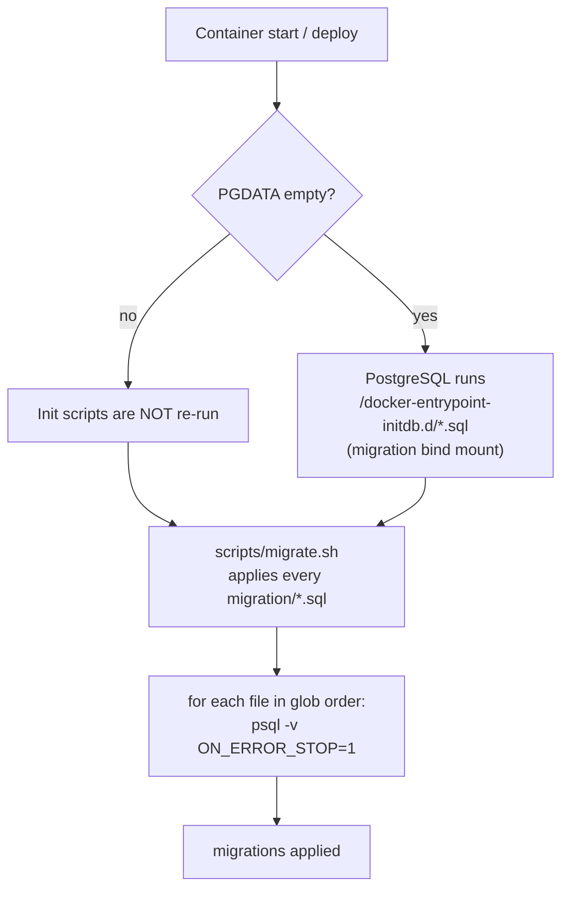

# Migrations

Schema changes live in `migration/*.sql` and are applied by two distinct paths:
PostgreSQL first-boot initialization and the explicit re-application script.
There is **no applied-migration tracking table**; idempotent SQL is the entire
safety mechanism.

## How migrations are applied



| Path | When | Command / source |
|---|---|---|
| First-boot init | Only when `PGDATA` is empty | `./migration` mounted at `/docker-entrypoint-initdb.d` (`docker-compose.yml:7`) |
| Re-application | Every deploy / explicitly via `just migrate` | `scripts/migrate.sh` (`:24-28`) |
| Test DB reset | Before integration tests | `scripts/setup-test-db.sh` (`:34-44`) |

### `scripts/migrate.sh`

- Sources `.env` if present (`:9-14`).
- Requires `PG_USER` and `PG_DBNAME`, failing fast if unset (`:16-17`).
- Aborts unless `docker compose ps --status running --services` lists `psql` as
  running (`:19-22`).
- Iterates `migration/*.sql` in **filename (glob) order**, piping each file into:

```bash
docker compose exec -T psql \
  psql -v ON_ERROR_STOP=1 -q -U "$PG_USER" -d "$PG_DBNAME" < "$migration"
```

!!! warning "Idempotency is the only guard"
    `ON_ERROR_STOP=1` stops on the first error **within a file**, but psql
    autocommit means earlier statements in that file can already be applied.
    There is no version table and no rollback script. Re-running the whole set
    converges because each file is written to be safe to repeat: `IF NOT
    EXISTS` in `01_schema.sql`, `CREATE OR REPLACE FUNCTION` in `02_pg_rank.sql`,
    and guarded `DO` / `DROP IF EXISTS` blocks in `03_index_completion.sql`.

## Migration files

| File | Purpose |
|---|---|
| `migration/01_schema.sql` | Extensions, six base tables, uniqueness constraints and base indexes. Fully idempotent. |
| `migration/02_pg_rank.sql` | `update_page_rank(...)` PL/pgSQL function (`CREATE OR REPLACE`). |
| `migration/03_index_completion.sql` | Completion marker for legacy databases, two partial indexes, cleanup of obsolete indexes and the `monitor_state` table. |

### `01_schema.sql`

Creates `pgcrypto` plus `urls`, `pages`, `words`, `page_word`, `graph_edges` and
`page_rank`, with `gen_random_uuid()` defaults, cascading foreign keys and the
base indexes. `image_page` and `urls.status` appear only as comments and are not
created. See [Schema](schema.md) for the full column and index reference.

### `02_pg_rank.sql`

Implements `update_page_rank(max_iterations INTEGER DEFAULT 20,
damping_factor FLOAT DEFAULT 0.85) RETURNS TABLE(out_url_id UUID, out_rank FLOAT)`.
Behavior verified in source:

1. Node set is `pages WHERE indexed = TRUE`. If empty, all `page_rank` rows are
   deleted and the function returns early (`02_pg_rank.sql:14-26`).
2. Three `ON COMMIT DROP` temp tables are created and truncated so the function
   can be called more than once in a transaction (`:31-43`, `:68-83`).
3. Every indexed page is seeded to `1.0 / node_num` (`:45-50`).
4. The graph is restricted to **indexed → indexed** edges, and out-degrees are
   computed from that same restricted set (`:85-96`); links to unindexed pages
   do not leak rank.
5. The loop runs exactly `max_iterations` passes — **there is no convergence
   check** (`:98-155`). Dangling rank is redistributed through the teleport term
   so total rank stays at 1.0 (`:101-132`).
6. Stale score rows are deleted, remaining scores upserted with
   `updated_at = NOW()` (`:157-179`); all scores are returned ordered by
   `score DESC` with no SQL `LIMIT` (`:181-187`).

The Ranking service calls this function with its own defaults of 20 iterations
and 0.85 damping (`services/ranking/src/calculator.py:30-32`, `:69-72`). IDF is
**not** in a migration: Ranking issues a separate single-statement SQL `UPDATE`
against `words.idf` (`services/ranking/src/calculator.py:11-28`).

### `03_index_completion.sql`

- Guarded `DO` block adds `pages.indexed_at` only if missing, and performs a
  one-time backfill: completed pages with `page_word` rows get a timestamp;
  bare claims are left `NULL` for normal reclamation (`:12-33`). On a fresh
  database created from `01_schema.sql` the column already exists, so this is a
  no-op.
- Adds partial indexes `idx_pages_open_claims` and
  `idx_pages_unindexed_updated` (`:35-43`).
- Drops `idx_page_word_word_id`, `monitor_state`, the reverse-pair unique index
  `idx_graph_edges_unique_revese` (which had discarded reciprocal links) and a
  duplicate edge index (`:45-59`).

## CI coverage

!!! warning "CI does not execute migrations"
    `infra_ci.yaml` checks only that `migration/*.sql` files exist and that each
    contains one of the keywords `create|alter|drop|insert|update`
    (`.github/workflows/infra_ci.yaml:36-39`). It does not run them, check
    idempotency, or verify the resulting schema. Treat a green CI run as no
    evidence that a migration works.

## Test database reset

`scripts/setup-test-db.sh` creates an isolated database (default `boogle_test`,
override `BOOGLE_TEST_DB`) using a host `psql` client rather than `docker exec`:

```bash
psql -h "$PGHOST" -p "$PGPORT" -U "$PGUSER" -d postgres \
  -v ON_ERROR_STOP=1 <<SQL
DROP DATABASE IF EXISTS ${TEST_DB};
CREATE DATABASE ${TEST_DB};
SQL

for f in "$ROOT"/migration/*.sql; do
  psql -h "$PGHOST" -p "$PGPORT" -U "$PGUSER" -d "$TEST_DB" \
    -v ON_ERROR_STOP=1 -q -f "$f"
done
```

The compose hostname `psql` falls back to `localhost` when it does not resolve
(`:14-21`). Integration tests use this reset path, not the production re-run
path.

!!! caution "`setup-test-db.sh` is destructive"
    It drops and recreates the target database without a confirmation prompt
    and carries a hardcoded fallback password (`:11`). Confirm `BOOGLE_TEST_DB`
    and `PG_*` values before running it; see [Testing](../development/testing.md).

## Related pages

- [Database overview](database.md)
- [Schema](schema.md)
- [Ranking: database functions](../services/ranking/database-functions.md)
- [Environment variables](../reference/environment-variables.md)
