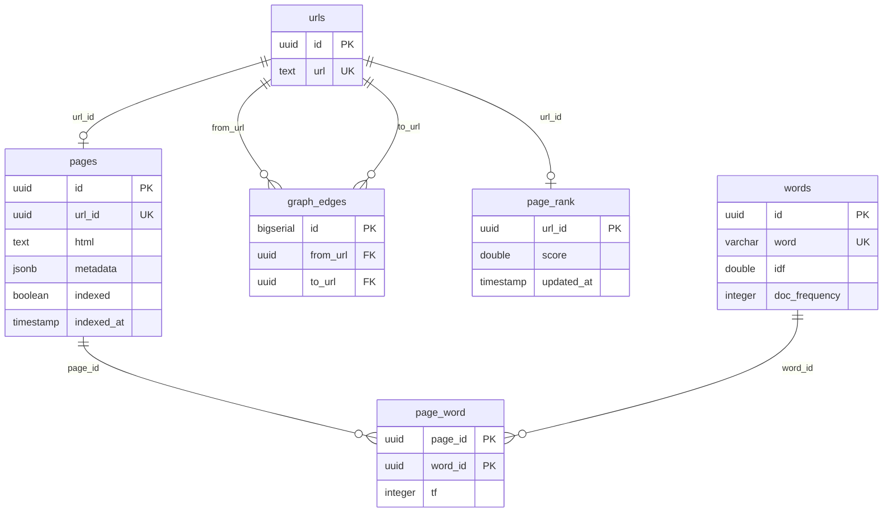

# Database Schema

The authoritative schema is defined by `migration/01_schema.sql` (base tables and
indexes) and `migration/03_index_completion.sql` (completion marker, sweep
indexes, cleanup). Every statement is idempotent because the same files are used
for first-boot init and for re-application by `scripts/migrate.sh`. This page
describes the **implemented** schema, not the stale legacy `docs/*.md` files.

## Entity relationships



`urls` to `pages` and `urls` to `page_rank` are one-to-zero-or-one; `page_word`
is the many-to-many join between `pages` and `words`; `graph_edges` is a
directed edge set keyed by URL pairs.

## Authoritative DDL

```sql
-- migration/01_schema.sql
CREATE EXTENSION IF NOT EXISTS pgcrypto;

CREATE TABLE IF NOT EXISTS urls (
    id UUID DEFAULT gen_random_uuid() PRIMARY KEY,
    url TEXT UNIQUE NOT NULL
);

CREATE TABLE IF NOT EXISTS pages (
    id UUID DEFAULT gen_random_uuid() PRIMARY KEY,
    url_id UUID UNIQUE NOT NULL REFERENCES urls(id) ON DELETE CASCADE,
    html TEXT NOT NULL,
    metadata JSONB NOT NULL DEFAULT '{}',
    indexed BOOLEAN NOT NULL DEFAULT FALSE,
    created_at TIMESTAMP NOT NULL DEFAULT NOW(),
    updated_at TIMESTAMP NOT NULL DEFAULT NOW(),
    last_index_attempt_at TIMESTAMP,
    indexed_at TIMESTAMP,
    index_attempts INT NOT NULL DEFAULT 0
);

CREATE TABLE IF NOT EXISTS words (
    id UUID DEFAULT gen_random_uuid() PRIMARY KEY,
    word VARCHAR(25) UNIQUE NOT NULL,
    idf DOUBLE PRECISION NOT NULL DEFAULT 1,
    doc_frequency INTEGER DEFAULT 0
);

CREATE TABLE IF NOT EXISTS page_word (
    page_id UUID NOT NULL REFERENCES pages(id) ON DELETE CASCADE,
    word_id UUID NOT NULL REFERENCES words(id) ON DELETE CASCADE,
    tf INTEGER NOT NULL CHECK (tf > 0),
    PRIMARY KEY (page_id, word_id)
);

CREATE TABLE IF NOT EXISTS graph_edges (
    id BIGSERIAL PRIMARY KEY,
    from_url UUID NOT NULL REFERENCES urls(id) ON DELETE CASCADE,
    to_url   UUID NOT NULL REFERENCES urls(id) ON DELETE CASCADE,
    UNIQUE (from_url, to_url)
);

CREATE TABLE IF NOT EXISTS page_rank (
    url_id UUID PRIMARY KEY REFERENCES urls(id) ON DELETE CASCADE,
    score   DOUBLE PRECISION NOT NULL,
    updated_at TIMESTAMP NOT NULL DEFAULT NOW()
);
```

## Column and value semantics

| Field | Meaning |
|---|---|
| `pages.indexed` | **Claim flag**, not completion. `TRUE` means a worker claimed the page; see [Claim vs completion](#claim-vs-completion). |
| `pages.indexed_at` | **Completion marker.** `NULL` means the claim is still open; a timestamp means indexing finished. |
| `pages.last_index_attempt_at` | Time of the last claim; cleared on successful completion. |
| `pages.index_attempts` | Incremented when a page is **claimed**, not when it fails, so an aborted worker still consumes budget. Reset to `0` on completion. |
| `pages.metadata` | Crawler-supplied `JSONB`, default `{}`. |
| `words.word` | `VARCHAR(25)`; Indexer drops longer tokens rather than truncating them. |
| `words.idf` | Stored on the `words` row by the Ranking pipeline, default `1`. Ranking computes IDF with a base-10 `LOG` over all pages; words with no `page_word` rows keep their prior value. |
| `words.doc_frequency` | Exists in the schema but is **not maintained** by the current Ranking code. |
| `page_word.tf` | **Raw integer occurrence count** from the HTML parser, constrained `> 0`; not a normalized ratio. Engine multiplies it by `idf` at query time. |
| `graph_edges` | Directed links between canonical URLs; only `UNIQUE (from_url, to_url)` applies, so reciprocal links are retained. |
| `page_rank` | One score row **keyed by `url_id`** (not `page_id`); `DOUBLE PRECISION`, rewritten by Ranking with `updated_at = NOW()`. |
| Timestamps | All are `TIMESTAMP` without time zone. |

## Claim vs completion

!!! important "Two fields, two meanings"
    `indexed = TRUE` means **claimed**. `indexed_at IS NOT NULL` means
    **completed**. The Indexer's reconciliation sweep reclaims only open claims
    (`indexed = TRUE AND indexed_at IS NULL`); it never releases completed pages.
    The split was added in `migration/03_index_completion.sql` to stop an earlier
    sweep from deleting every finished page's `page_word` rows.

```sql
-- Claim: one statement, FOR UPDATE SKIP LOCKED
-- services/indexer/src/core/psql.rs:144-167
WITH cte AS (
  SELECT id, url_id, html FROM pages
  WHERE indexed = FALSE AND id = $1 AND index_attempts < $2
  FOR UPDATE SKIP LOCKED LIMIT 1
)
UPDATE pages
SET indexed = TRUE, indexed_at = NULL,
    last_index_attempt_at = NOW(),
    index_attempts = pages.index_attempts + 1
FROM cte WHERE pages.id = cte.id
RETURNING pages.id, pages.url_id, pages.html;

-- Completion: guarded so a late worker cannot restamp a newer claim
-- services/indexer/src/core/psql.rs:58-85
UPDATE pages
SET indexed_at = NOW(), last_index_attempt_at = NULL, index_attempts = 0
WHERE id = $1 AND indexed = TRUE AND indexed_at IS NULL;
```

The confirmation message is published **after** the word write but **before**
`mark_indexed`, so Ranking may run while a page is claimed but not yet stamped.
Its PageRank node set is `pages WHERE indexed = TRUE` — claims, not completed
pages. See [Message contracts](message-contracts.md).

## Indexes

| Index | Definition | Purpose |
|---|---|---|
| `idx_words_word` | UNIQUE on `words(word)` | term lookup (`w.word = ANY($1)`) and uniqueness |
| `idx_pages_url_id` | UNIQUE on `pages(url_id)` | one page per URL |
| `idx_page_word_page_id` | on `page_word(page_id)` | per-page term sets |
| `idx_page_word_word_page` | UNIQUE on `(word_id, page_id)` | inverted lookup; also enforces the join uniqueness |
| `idx_graph_edges_from_page` | on `graph_edges(from_url)` | outgoing edges |
| `idx_graph_edges_to_page` | on `graph_edges(to_url)` | incoming edges |
| `idx_page_rank_score` | on `page_rank(score DESC)` | score ordering |
| `idx_pages_open_claims` | on `pages(last_index_attempt_at)` WHERE `indexed = TRUE AND indexed_at IS NULL` | partial index for the stale-claim sweep (`migration/03_index_completion.sql:37-39`) |
| `idx_pages_unindexed_updated` | on `pages(updated_at)` WHERE `indexed = FALSE` | partial index for unindexed-page selection (`:41-43`) |

`idx_page_word_word_id`, `idx_graph_edges_unique_revese` and a duplicate
`idx_graph_edges_unique` are dropped by migration 03; the latter had silently
discarded reciprocal links.

## Removed and never-created tables

!!! note "Do not document these as live tables"
    `monitor_state` was dropped in `migration/03_index_completion.sql:49-50`;
    there is no monitoring service reading it. `image_page` exists **only as a
    comment** in `migration/01_schema.sql:51-56` and was never created. A
    commented-out `urls.status` column is likewise inactive
    (`migration/01_schema.sql:8`).

## Lifecycle by service

| Service | Writes | Reads |
|---|---|---|
| [Spider](../services/spider/index.md) | `urls`, `pages` (new rows), `graph_edges` | — |
| [Indexer](../services/indexer/index.md) | `words`, `page_word`, `pages` claim/completion fields | `pages` |
| [Ranking](../services/ranking/index.md) | `words.idf`, `page_rank` | `pages`, `page_word`, `graph_edges` |
| [Engine](../services/engine/index.md) | nothing (read-only) | `words`, `page_word`, `pages`, `page_rank`, `urls` |

Foreign keys cascade on delete: dropping a `urls` row removes its page, scores
and edges; dropping a `pages` or `words` row removes its `page_word` links.
See [Database overview](database.md) for connection details and
[Migrations](migrations.md) for how this schema is applied.
