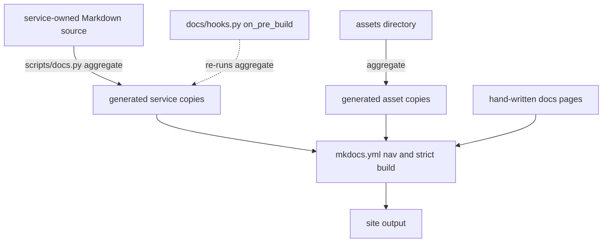

# Documentation

The site is a single MkDocs + Material project. Service teams own their
Markdown; a small Python script aggregates it into the central tree before
every build. The generated copies are ignored by Git.

## How the pieces fit



| File | Role |
|---|---|
| `services/<svc>/docs/` | **Source of truth** for service pages |
| `scripts/docs.py` | Aggregates service docs and assets; builds, serves, checks |
| `docs/hooks.py` | MkDocs `on_pre_build` hook that re-runs `aggregate` |
| `mkdocs.yml` | Site config, navigation, theme, Markdown extensions |
| `docs/services/<svc>/` | Generated copies — **do not edit** |
| `docs/assets/` | Generated copies of `assets/` — **do not edit** |
| `.gitignore` | Ignores all generated docs paths and `.venv-docs/` |

`exclude_docs` in `mkdocs.yml` keeps the legacy root files (`ARCHITECTURE.md`,
`ENGINE.md`, `INDEXER.md`, `RANKING.md`, `SPIDER.md`, `Notes.md`) out of the
strict build. They remain for provenance but are historical, not authoritative;
several claims in them are stale. See
[Project structure](project-structure.md).

## Setup

Dependencies are pinned in `docs/requirements.txt` (`mkdocs==1.6.1`,
`mkdocs-material==9.6.23`). Install into the dedicated virtualenv:

```bash
just docs-install
# equivalent: python3 scripts/docs.py install
```

This creates `.venv-docs/` if needed. `scripts/docs.py` prefers
`.venv-docs/bin/mkdocs`, then `mkdocs` on `PATH`; the `MKDOCS` environment
variable overrides the executable.

## Commands

| Recipe | Script command | Result |
|---|---|---|
| `just docs-install` | `python3 scripts/docs.py install` | create/update `.venv-docs/` |
| `just docs-build` | `python3 scripts/docs.py build` | aggregate, then `mkdocs build --strict` into `site/` |
| `just docs-serve` | `python3 scripts/docs.py serve` | aggregate, then `mkdocs serve --strict` at `127.0.0.1:8000` |
| `just docs-service <svc>` | `python3 scripts/docs.py service <svc>` | standalone site in `site-services/<svc>/` |
| `just docs-check` | `python3 scripts/docs.py check` | aggregate + nav completeness + strict build |

The underlying script also exposes `aggregate --service <svc>` for copying one
service's pages without building. Preview the full site with:

```bash
just docs-serve
```

!!! note "Two refresh paths"
    `build`, `serve`, and `check` call `aggregate()` directly; `hooks.py` also
    refreshes the copies on MkDocs' `on_pre_build`. The copy is idempotent and
    safe to run twice.

## Editing existing service pages

1. Edit the source file under `services/<svc>/docs/`, for example
   `services/spider/docs/configuration.md`.
2. Keep the filename and its `mkdocs.yml` nav entry in sync. `docs-check`
   fails if an aggregated page is not in the nav, or if a nav target is missing.
3. Run `just docs-check`, then open a PR. Never edit `docs/services/...`
   directly — the next aggregate overwrites it.

## Adding a new service page

There are three required steps:

1. Create the Markdown file in `services/<svc>/docs/`.
2. Add its **exact filename** to that service's `EXPECTED_PAGES` tuple in
   `scripts/docs.py`. Aggregation fails with a clear error when an expected
   page is missing.
3. Add the generated path (`services/<svc>/<filename>` as seen from `docs/`,
   i.e. `services/<svc>/...` in `mkdocs.yml`) to the service's nav section.

Images and other allowed assets (`.md`, `.png`, `.jpg`, `.jpeg`, `.gif`,
`.svg`, `.webp`) are copied automatically; hidden files and other extensions
are skipped. Reference images with relative paths that work in both the source
tree and the generated tree.

!!! warning "Marker safety check"
    `docs/services/<svc>/` and `docs/assets/` are managed directories marked
    with a `.generated-by-scripts-docs-py/` subdirectory. If a target directory
    already exists **without** that marker, `scripts/docs.py` refuses to
    overwrite it. Do not create files there by hand; if you already have local
    work there, move it back to `services/<svc>/docs/` and remove the stale
    directory before re-running aggregation.

## Standalone service sites

```bash
just docs-service spider
just docs-service ranking
```

This aggregates only that service, derives a small nav from the `Services`
section of `mkdocs.yml`, and writes to `site-services/<svc>/`. It intentionally
drops the global hook and ignores other files omitted from the reduced nav.
`docs_ci.yaml` builds all four standalone sites after the full-site check so a
service's pages do not rely on unrelated site content.

## Writing guidelines

- Use **relative** Markdown links. From a development page, link to a service
  page as `../services/indexer/index.md`, and to reference material as
  `../reference/commands.md` or `../reference/known-issues.md`.
- Use the admonition syntax already enabled by `mkdocs.yml` (`!!! note`,
  `!!! warning`, `!!! tip`, `!!! danger`).
- Mermaid fences work through `pymdownx.superfences`; keep diagrams small and
  support them with a table or prose. In Mermaid node labels, prefer plain text
  (`service-owned docs`) over raw HTML entities with angle brackets.
- Code fences use `pymdownx.highlight`; add a language for copy buttons and
  correct highlighting.
- Include a `Last verified`/date note only when the content is time-sensitive;
  prefer phrasing such as "as of 2026-11-23" with a concrete source file.
- Only document verified behavior. If something could not be confirmed, say so
  explicitly rather than presenting it as fact — see the unverified claims
  listed at the end of [Environment setup](setup.md) and the gaps in
  [Testing](testing.md).

## CI validation

`.github/workflows/docs_ci.yaml` runs on PRs and pushes that touch `mkdocs.yml`,
`docs/**`, `services/*/docs/**`, `scripts/docs.py`, the justfiles, READMEs, or
the workflow itself. With Python 3.12 it:

1. installs `docs/requirements.txt`;
2. runs `python scripts/docs.py check`;
3. builds each of the four standalone service sites.

The full-site check additionally verifies that every aggregated service page
appears in nav and that every nav target exists. MkDocs `--strict` turns broken
links, missing nav targets, and invalid config into failures; the
`validation:` block in `mkdocs.yml` sets several link/nav issues to `warn`, but
the explicit checks in `scripts/docs.py` still fail the build.

!!! note "Full-site check during concurrent authoring"
    At the time of writing, `docs-check` also reports missing nav targets for
    sections still being authored (for example getting-started, operations,
    and reference pages). Those files are listed in `mkdocs.yml` nav but not yet
    on disk; the check passes once every nav target exists.

## Related pages

- [Project structure](project-structure.md)
- [Contributing](contributing.md)
- [Commands reference](../reference/commands.md)
