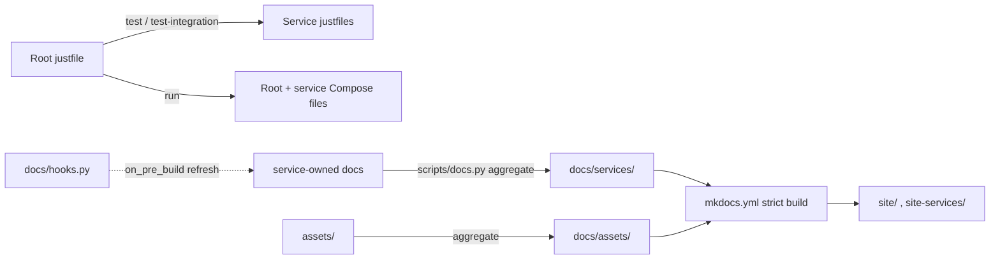

# Project structure

Boogle is a single Git repository with a shared infrastructure stack, four
independent services, and one central documentation site. The root `justfile`
fans out to service justfiles; it does not own service source code.

## Top-level layout

```text
boogle/
├── docker-compose.yml          # shared datastores: psql, redis, rabbitmq, adminer
├── justfile                    # root recipes: test, env, run, migrate, docs-*
├── mkdocs.yml                  # central site config + navigation
├── .env.example                # root credential/tuning template
├── .github/workflows/          # per-service CI, CD, infra CI, docs CI
├── migration/                  # 01_schema.sql, 02_pg_rank.sql, 03_index_completion.sql
├── scripts/                    # docker-env.sh, migrate.sh, setup-test-db.sh, docs.py
├── assets/                     # images aggregated into docs/assets/
├── docs/                       # central + generated Markdown, hooks.py, theme JS
│   ├── development/            # these pages (hand-written)
│   ├── services/<svc>/         # GENERATED copies of service-owned docs
│   ├── assets/                 # GENERATED copies of assets/
│   ├── hooks.py                # MkDocs pre-build refresh hook
│   └── *.md                    # legacy historical docs (excluded from build)
└── services/
    ├── engine/
    ├── spider/
    ├── indexer/
    └── ranking/
```



## Source of truth by area

| Area | Canonical location | Notes |
|---|---|---|
| Shared infrastructure | `docker-compose.yml`, `docker-env.sh`, service Compose files | `search_net` is created by the root Compose file; service files attach externally. |
| Database schema | `migration/*.sql` | Applied by `scripts/migrate.sh`; test DB recreated by `scripts/setup-test-db.sh`. |
| Build and dev commands | Root and service `justfile` files | Dockerfile builder stages are authoritative for container images. |
| Service behavior | `services/<svc>/` source and `services/<svc>/docs/` | Service teams own their Markdown; generated copies are not edited. |
| Documentation site | `mkdocs.yml`, `scripts/docs.py`, `docs/hooks.py`, hand-written `docs/**` | See [Documentation](documentation.md). |
| CI/CD | `.github/workflows/*.yaml` | Path-filtered PR checks; tag-triggered image publication. |

## Service subtrees

| Service | Key paths |
|---|---|
| engine | `cmd/server/`, `cmd/cli/`, `internal/{handlers,store,service,config,model,util,apperror}/`, `view/**/*.templ`, `static/{css,js}/`, generated `public/` |
| spider | `cmd/spider/`, `internal/{spider,policy,state,store,parser,messaging,config,utils}/` |
| indexer | `src/main.rs`, `src/core/{indexer,psql,messaging,config,errors,utils,text_sink}.rs`, `.sqlx/` offline query data |
| ranking | `src/{main,calculator,messaging,psql}.py`, `tests/` (unit plus `tests/integration/`) |

All four services keep their own README and a `docs/` directory. The service
`docs/` trees are the source for the aggregated site pages; see
[Contributing](contributing.md) for what to update when behavior changes.

## Generated and ignored paths

`.gitignore` marks the following as generated output (do not hand-edit):

- `docs/services/` — aggregated copies of `services/<svc>/docs/`
- `docs/assets/` — copies of `assets/`
- `.venv-docs/`, `.docs-build/`, `site/`, `site-services/` — docs venv, temp config/check output, full site, per-service sites
- service build products: `*_templ.go`, `public/`, `bin/`, `target/`, `venv/`, `node_modules/`, `coverage.out`, logs

The legacy root files `docs/ARCHITECTURE.md`, `ENGINE.md`, `INDEXER.md`,
`RANKING.md`, `SPIDER.md`, and `Notes.md` remain for provenance but are excluded
from the MkDocs tree via `exclude_docs` in `mkdocs.yml`. They are historical,
not authoritative; several claims in them are stale.

## Related pages

- [Environment setup](setup.md)
- [Testing](testing.md)
- [Documentation](documentation.md)
- [Commands reference](../reference/commands.md)
