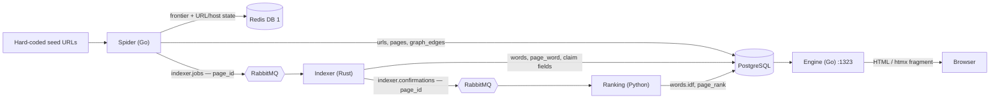

# Boogle

**Last updated:** 2026-11-23

Boogle is a self-contained, four-service search engine built as a **learning project**. A crawler discovers public web pages, an indexer builds an inverted index in PostgreSQL, a ranking service recomputes IDF and PageRank scores, and a Go web service serves a `templ` + `htmx` search UI. The services coordinate through one shared PostgreSQL database and two RabbitMQ queues; the crawler additionally uses Redis for its URL frontier and crawl-state.

!!! note "Scope of this site"
    These pages describe the **implemented** behavior verified from `services/`, `migration/`, and the root build files. The older root-level `docs/ENGINE.md`, `docs/SPIDER.md`, and similar files are historical and are excluded from this site.

## Implemented pipeline

1. The **Spider** pops a due URL from the Redis frontier, fetches it with a public-only HTTP client, and commits `urls`, `pages`, and `graph_edges` in one transaction. Only after that commit does it publish an `indexer.jobs` message.
2. The **Indexer** claims the page (`indexed = TRUE`, `indexed_at = NULL`), tokenizes the stored HTML, writes `words` and `page_word`, publishes an `indexer.confirmations` message, marks the page complete, and ACKs the job.
3. **Ranking** counts confirmations; at a threshold (default 100), or once at startup, it recomputes `words.idf` and the whole `page_rank` table in PostgreSQL.
4. The **Engine** serves `GET /search` by reading the index, re-ranking a bounded candidate window in Go, and rendering HTML or an htmx fragment.

## What works today

| Capability | Status |
|---|---|
| Crawler with robots/policy admission, SSRF guard, Redis frontier, transactional persistence | Implemented |
| Asynchronous indexing with at-least-once delivery, claims, and a stale-claim sweep | Implemented |
| IDF and PageRank recomputation triggered by confirmation batches | Implemented |
| Search UI with spellcheck suggestions, TF-IDF/PageRank blend, pagination | Implemented |
| Images and Graph result tabs | Placeholders that always render "no results" |
| "I'm Feeling Lucky" | Hard-coded text response, not a random result |
| Authentication, result caching, metrics/tracing | Not implemented |

!!! warning "Known cross-service caveats"
    Re-crawled content is not re-indexed because the Spider upsert leaves the page marked indexed (X-01), and the three components that decide "which pages count" use different predicates (X-02). Both are described in [Services](architecture/services.md) and [Data flow](architecture/data-flow.md).

## Quick links

- [Getting started: quick start](getting-started/quick-start.md) — bring the stack up locally.
- [Architecture overview](architecture/overview.md) — services, queues, and shared state.
- [Services](services/spider/index.md) — start with the [Spider](services/spider/index.md), then [Engine](services/engine/index.md), [Indexer](services/indexer/index.md), and [Ranking](services/ranking/index.md).
- [Known issues](reference/known-issues.md) — verified limitations and open gaps.

## Project status

This is a study codebase, not a production deployment. Datastores and admin UIs publish on `127.0.0.1` only, the Engine publishes `1323` on all host interfaces, placeholder credentials are used in env examples, there is no monitoring service, and three of the four service Docker healthchecks only check that a process is alive. See [Infrastructure](architecture/infrastructure.md) for the exact topology and caveats.
