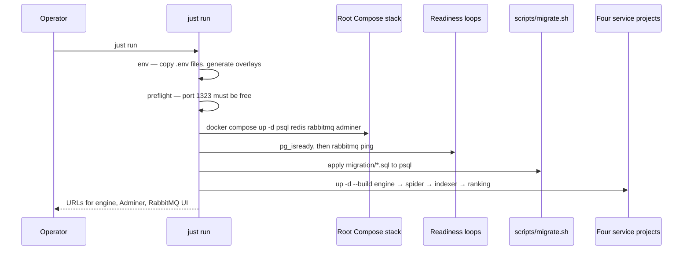

# Deployment

**Last updated:** 2026-11-23

Boogle is a **learning project**. The shipped Compose topology is intended for local development and demonstrations, not production.

!!! danger "Not production-ready"
    There is no authentication, no TLS, no resource limit, no log rotation, no backup job, and no health-gated startup. Credentials ship as `change-me-*` placeholders; the engine port is published on all host interfaces. The datastore and UI ports are loopback-only, but that is the only network boundary in the default setup.

## Prerequisites

| Requirement | Why |
|---|---|
| Docker Engine + Compose V2 | All runtime services are containers. The long `env_file: { path, required }` syntax needs Compose **2.24+**. |
| `just` | Root recipes drive env generation, startup, migration, logs and shutdown. |
| `python3` | `scripts/docker-env.sh` uses `urllib.parse` to URL-encode credentials. |
| Git | Required by the documented setup flow. |
| `ss` (optional) | `just preflight` only performs the port-1323 check when `ss` is on `PATH`. |

Local test recipes need additional host tooling (Go 1.27+, Rust/cargo, Python 3.12 with an installed `venv`, and a host `psql` client for `just test-db`). See [Prerequisites](../getting-started/prerequisites.md) and [Testing](../development/testing.md).

## Local deployment

### 1. Bootstrap configuration

```bash
just env
```

This copies missing `.env` files from each `.env.example`, then generates the `services/*/.env.docker` overlays from the root `.env`. Edit the root `.env` first: `PG_PASSWORD`, `REDIS_PASSWORD`, `RABBITMQ_DEFAULT_USER`, `RABBITMQ_DEFAULT_PASS` and the other `change-me-*` placeholders are real inputs, not optional decoration.

- Existing `.env` files are never overwritten; re-running `just env` **does** regenerate the overlays.
- Overlay keys win over the same keys in a service `.env` because of `env_file` ordering. See [Docker Compose layout](docker.md#generated-environment-overlays).
- The root `.env` supplies shared credentials; per-service `.env` files supply tuning values not present in the overlays.

### 2. Start the stack

```bash
just run
```



`just infra-up` waits only for Postgres and RabbitMQ. It does not wait for Redis, and there is no per-service readiness gate: Compose has no `depends_on` between the application services and the datastores. Startup order is provided by the `justfile`, not by Compose.

### 3. Verify

| Check | Expected |
|---|---|
| `docker compose ps` | Root containers `psql`, `redis`, `rabbitmq`, `adminer` running; `pg_isready` / Redis ping / RabbitMQ ping report healthy |
| `GET http://localhost:1323/health` | `200` with `{"status":"ok"}` — this is a static response and does **not** verify Postgres or aspell |
| `http://127.0.0.1:8080` | Adminer login form; select the `psql` server and log in with the configured credentials |
| `http://127.0.0.1:15672` | RabbitMQ Management UI; queues `indexer.jobs` and `indexer.confirmations` exist once producers/consumers connect |
| `just run-logs` | Tails the last 100 lines of all four service containers; Ctrl-C stops only the streams |

See [Monitoring](monitoring.md) for the limits of these checks and [Logging](logging.md) for where each service writes.

### 4. Stop

```bash
just stop
```

This runs `down` for each service project and then for the root project. `pgdata` is retained, so the corpus survives a normal stop/start cycle. Deleting that volume discards the corpus; no backup job exists.

## Migrations

```bash
just migrate
```

- `scripts/migrate.sh` sources the root `.env`, requires `PG_USER` and `PG_DBNAME`, and aborts unless `psql` is running.
- It applies every `migration/*.sql` in filename order via `docker compose exec -T psql psql -v ON_ERROR_STOP=1 -q ...`.
- Migration files are idempotent and safe to re-run; there is no applied-migration tracking table. Postgres' `/docker-entrypoint-initdb.d` runs only on an empty `PGDATA`, so `migrate.sh` is the path for later schema changes.
- A failure partway through a file can leave earlier statements applied (psql autocommit); re-running converges.

See [Migrations](../data/migrations.md) for the schema-level detail.

## Restart and upgrade behavior

- All containers use `restart: unless-stopped`. Compose will restart a crashed container, but there is no readiness ordering when the host or Compose stack comes back.
- The engine opens its database pool and pings Postgres at boot (10s timeout), failing fast when the database is unavailable. Repeated restarts while Postgres is down are expected.
- Entrypoints fail fast on missing required environment variables; see the table in [Docker Compose layout](docker.md#images-and-entrypoints).
- Healthchecks do not gate anything: no `depends_on: condition: service_healthy` exists for the application services, and three of the four service healthchecks only check that a process is alive.
- There is no rolling deploy. `just stop` followed by `just run` rebuilds each image (`--build`) and restarts the whole stack, retaining `pgdata`.
- Redis has no volume or append-only persistence. A Redis restart loses crawl-frontier state; re-crawl behavior has a known cross-service defect (see [Troubleshooting](troubleshooting.md#symptom-cause-check-action)).

## Published images and CI/CD

Four CD workflows build and publish images; none of them deploy anything.

| Workflow | Trigger | Result |
|---|---|---|
| `.github/workflows/engine_cd.yaml` | tag `engine@v*` | `ghcr.io/<repo>/engine:<version>` and `:latest` |
| `.github/workflows/spider_cd.yaml` | tag `spider@v*` | `ghcr.io/<repo>/spider:<version>` and `:latest` |
| `.github/workflows/indexer_cd.yaml` | tag `indexer@v*` | `ghcr.io/<repo>/indexer:<version>` and `:latest` |
| `.github/workflows/ranking_cd.yaml` | tag `ranking@v*` | `ghcr.io/<repo>/ranking:<version>` and `:latest` |

Each workflow builds from the service directory with `docker build`, logs in to GHCR with `GITHUB_TOKEN`, and pushes both tags.

!!! note "Publishing is not deploying"
    No service `docker-compose.yml` references a GHCR image — they all use `build: .`. There is no deploy job, no environment protection, no signing/provenance, and no integration test in CD. Consuming a published image here requires editing the relevant Compose file to add an `image:` key.

CI runs on pull requests: path-scoped per-service test workflows (the ranking suite has an 80% coverage gate), `infra_ci.yaml` validates all five Compose files with `--env-file .env config -q`, runs `shellcheck` over scripts/entrypoints, and checks that migration files exist. `docs_ci.yaml` validates the MkDocs site. See [Documentation](../development/documentation.md).

## Secrets and exposure

- Credentials live in the ignored root `.env` and are projected into ignored `services/*/.env.docker` overlays by `just env`. No secret values are tracked in the repository.
- `RABBITMQ_DEFAULT_USER` / `RABBITMQ_DEFAULT_PASS` in the root `.env` are mapped to `RABBITMQ_USER` / `RABBITMQ_PASSWORD` in the spider overlay and to AMQP URLs for indexer/ranking.
- TLS is not configured: `PG_SSLMODE` is not generated by the overlay and the engine forces `disable` when it is empty; other DSNs likewise carry no TLS parameters.
- There is no authentication on the engine. Its in-process Echo rate limiter (20 req/s per identity) trusts forwarding headers and is bypassable on the public binding; this is a review-verified finding, not a config knob. See [Known issues](../reference/known-issues.md).
- The engine request logger deliberately omits query text; see [Logging](logging.md#redaction-and-sensitive-data).
- No `deploy:` limits or restart budgets are configured. Log retention uses the Docker default driver; there is no rotation, aggregation, or alerting.

!!! warning "Credential overlays enter builder layers"
    `.dockerignore` excludes `**/.env` but not `**/.env.docker`, and all four Dockerfiles copy the whole build context in a builder stage. Locally generated credential overlays therefore enter builder layers and the build cache. Final runtime stages copy only compiled artifacts, so published images do not directly contain the overlays, and CI checkouts contain none.
