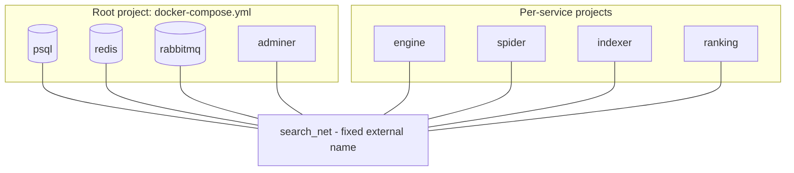

# Docker Compose layout

**Last updated:** 2026-11-23

Boogle uses five Compose projects: one root project for the shared infrastructure and one project per application service. All five attach to the fixed-name `search_net` bridge network. Compose never pulls a service image — each service has `build: .` and no `image:` key.

For the operator workflow, see [Deployment](deployment.md). For what the healthchecks actually prove, see [Monitoring](monitoring.md).

## Topology

`search_net` is declared with `name: search_net` in `docker-compose.yml`, so per-service files can attach it as `external: true`. The only named volume is `pgdata`.

## Root infrastructure stack

All four root services set `restart: unless-stopped` and publish on `127.0.0.1` only. There are no `logging:` blocks, no `deploy:` resource limits, and no `command:` overrides except Redis.

| Service | Image | Host port | Healthcheck | Data / notes |
|---|---|---|---|---|
| `psql` | `postgres:18.6-alpine3.24` | `127.0.0.1:${PG_PORT}:5432` | `pg_isready -U $POSTGRES_USER -d $POSTGRES_DB`, 5s / 5s / 10 retries | `./migration` bind-mounted to `/docker-entrypoint-initdb.d`; `pgdata` mounted at `/var/lib/postgresql` (the parent of `data`) |
| `redis` | `redis:alpine3.23` | `127.0.0.1:${REDIS_PORT}:6379` | `redis-cli -a "$REDISCLI_AUTH" ping` piped to `grep -q PONG`, 5s / 5s / 10 retries | Started with `--requirepass ${REDIS_PASSWORD}`; `REDISCLI_AUTH` injected as container env; no volume |
| `rabbitmq` | `rabbitmq:4-management-alpine` | `127.0.0.1:5672` (AMQP), `127.0.0.1:15672` (management UI) | `rabbitmq-diagnostics -q ping`, 10s / 10s / 12 retries | Credentials from `RABBITMQ_DEFAULT_USER` / `RABBITMQ_DEFAULT_PASS`; no volume |
| `adminer` | `adminer:5` | `127.0.0.1:8080` | none | Only `depends_on` in the repository: waits for `psql` with `condition: service_healthy` |

!!! note "Escaped variables in healthchecks"
    `$${POSTGRES_USER}`, `$${POSTGRES_DB}` and `$${REDISCLI_AUTH}` in `docker-compose.yml` become literal `$...` inside the container, where those variables are supplied by the service's `environment:` block. They are not expanded by Compose from the host shell.

## Per-service projects

`services/<svc>/docker-compose.yml` each define exactly one container. Every one uses `restart: unless-stopped`, attaches to `external: true` `search_net`, and declares **no** `depends_on`, compose-level healthcheck, volume, or `command:`.

| Project file | Build context | Container | Host port | `env_file` (in order) |
|---|---|---|---|---|
| `services/engine/docker-compose.yml` | `services/engine` | `engine` | `1323:1323` — **all interfaces** | `.env`, `.env.docker` |
| `services/spider/docker-compose.yml` | `services/spider` | `spider` | none | `.env`, `.env.docker` |
| `services/indexer/docker-compose.yml` | `services/indexer` | `indexer` | none | `.env`, `.env.docker` |
| `services/ranking/docker-compose.yml` | `services/ranking` | `ranking` | none | `.env`, `.env.docker` |

Both `env_file` entries use the long `{ path, required: false }` syntax, which requires Compose 2.24 or newer. Because the files are optional, a bare Compose invocation can start with `.env` alone — but the generated overlays are what supply container-network addresses.

!!! warning "The engine port is not loopback-bound"
    Unlike the root stack, `services/engine/docker-compose.yml` publishes `1323:1323` on every host interface. There is no authentication or TLS on the engine. See the rate-limit/public-exposure finding in [Known issues](../reference/known-issues.md).

## Images and entrypoints

Every final image is based on `alpine:3.23`, creates a system user/group `app` with uid/gid **10001**, runs as `USER 10001:10001`, and uses `ENTRYPOINT ["/entrypoint.sh"]`. The entrypoints run under `set -eu`, fail fast when required variables are missing, export defaults, create log directories where needed, and `exec` the service binary.

| Service | Builder stage(s) | Final payload | Hard-required env vars in `entrypoint.sh` |
|---|---|---|---|
| engine | `node:22-alpine3.23` (`npm ci`, Tailwind CSS + esbuild production assets); `golang:1.27.1-alpine3.23` (`aspell-dev`, templ `v0.3.1020`, `just build-emb` with CGO) | `/app/boogle`, `/app/public`; runtime adds `aspell aspell-en` | `PG_HOST`, `PG_PORT`, `PG_DBNAME`, `PG_USER`, `PG_PASSWORD` |
| spider | `golang:1.27.1-alpine3.23` (`build-base`, `just`; templ `v0.3.943` is installed but the build recipe does not generate templates) | `/app/spider`; `/app/logs` created and chowned | The five `PG_*` vars, `REDIS_ADDR`, `REDIS_PORT`, `RABBITMQ_USER`, `RABBITMQ_PASSWORD`, `RABBITMQ_HOST` |
| indexer | `rust:alpine3.23` (`musl` target, `SQLX_OFFLINE=true`, `RUSTFLAGS="-C target-cpu=x86-64-v2"`) | musl `/app/indexer`; `/app/logs` created | `DATABASE_URL`, `RABBITMQ_URL`, `RABBITMQ_QUEUE`, `RABBITMQ_CONFIRMATION_QUEUE` |
| ranking | `python:3.12-alpine` (`pip install --prefix=/install`, `pyinstaller --onefile`) | `/app/main`; runtime adds `zlib`, `libstdc++`, `libpq` | Either `DATABASE_URL` **or** all five `PG_*`; either `BROKER_URL`/`RABBITMQ_URL` **or** `RABBITMQ_USER` + `RABBITMQ_PASSWORD` |

Notes:

- Engine builds with `CGO_ENABLED=1` and links go-aspell, which is why the runtime image installs `aspell` and `aspell-en`.
- The indexer's local `just build` uses `-C target-cpu=native`; the Docker/CI build deliberately uses `x86-64-v2` so the image does not SIGILL on older hosts.
- The engine entrypoint exports `DEBUG` and `LOG_LEVEL`, but no Go code reads them. Treat them as inert in the current image.
- Service healthchecks are declared in the **Dockerfiles**, not in Compose: see [Monitoring](monitoring.md#healthchecks-that-exist).

## Generated environment overlays

`just env` copies any missing `.env` templates (root and four services), never overwriting existing files, then runs `scripts/docker-env.sh`. That script:

- requires `PG_USER`, `PG_PASSWORD`, `PG_DBNAME`, `RABBITMQ_DEFAULT_USER`, `RABBITMQ_DEFAULT_PASS` from the root `.env`;
- requires `python3` for URL-encoding credentials;
- treats `REDIS_PASSWORD` as optional (empty by default);
- writes one untracked `services/<svc>/.env.docker` per service.

| Overlay | Generated keys |
|---|---|
| `services/engine/.env.docker` | Five `PG_*` keys, with `PG_HOST=psql`, `PG_PORT=5432` |
| `services/spider/.env.docker` | Five `PG_*` keys, `REDIS_ADDR=redis`, `REDIS_PORT=6379`, `REDIS_PASSWORD`, `RABBITMQ_HOST=rabbitmq`, `RABBITMQ_PORT=5672`, `RABBITMQ_USER`, `RABBITMQ_PASSWORD`, `LOGS_PATH=/app/logs/logs.json` |
| `services/indexer/.env.docker` | `DATABASE_URL` and `RABBITMQ_URL` with percent-encoded credentials |
| `services/ranking/.env.docker` | Five `PG_*` keys, `BROKER_URL`, `RABBITMQ_URL` |

Compose reads `.env` first and `.env.docker` second, so overlay values win for overlapping keys. Non-overlapping keys — for example `PG_SSLMODE`, queue names, and ranking thresholds — come from the service `.env` or code defaults. Re-running `just env` regenerates overlays from the root `.env`, so edit the root file for shared credentials.

!!! warning "Overlays are in the build context"
    The `.dockerignore` files exclude `**/.env` but **not** `**/.env.docker`, and all four builder stages run `COPY . .`. See [Secrets and exposure](deployment.md#secrets-and-exposure).

## Compose commands used by the workflow

These are the exact commands behind the root `justfile` recipes; see [Commands](../reference/commands.md) for the recipe list.

| Command | Purpose |
|---|---|
| `docker compose up -d psql redis rabbitmq adminer` | `just infra-up` starts the root stack |
| `docker compose exec -T psql pg_isready -U "${PG_USER:-admin}"` | `just infra-up` waits for Postgres |
| `docker compose exec -T rabbitmq rabbitmq-diagnostics -q ping` | `just infra-up` waits for RabbitMQ |
| `docker compose exec -T psql psql -v ON_ERROR_STOP=1 -q -U "$PG_USER" -d "$PG_DBNAME" < "$migration"` | `scripts/migrate.sh` applies each `migration/*.sql` |
| `docker compose -f services/<svc>/docker-compose.yml up -d --build` | `just run` builds and starts each service |
| `docker logs -f --tail=100 <service>` | `just run-logs` follows the four service containers |
| `docker compose -f services/<svc>/docker-compose.yml down`, then `docker compose down` | `just stop` tears down services, then infra; `pgdata` is kept |
