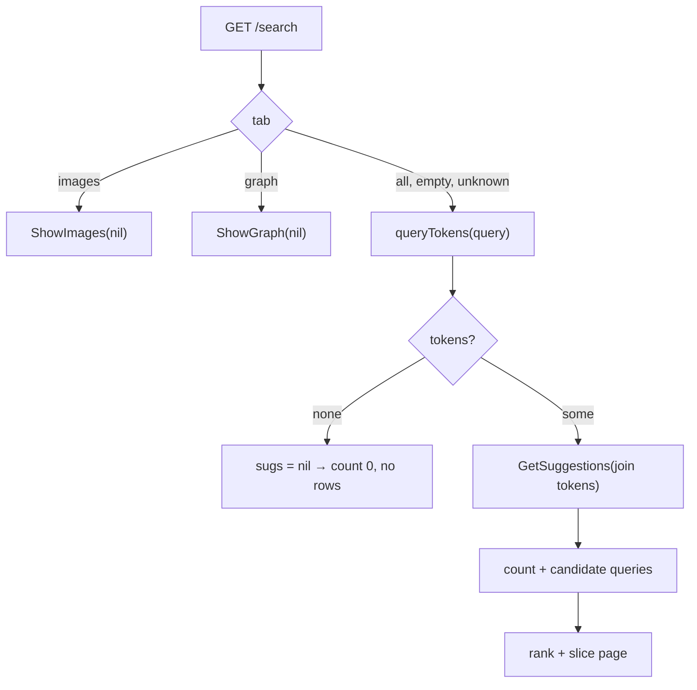

# Engine HTTP interface

**Last updated:** 2026-11-23

The Engine exposes a small HTTP surface on `:1323`. All routes are `GET`. HTML is the normal response format; the only JSON response is `/health`. Errors are always HTML — there is no `Accept` negotiation.

## Routes

| Method | Path | Handler | Response |
|---|---|---|---|
| `GET` | `/` | `HomeHandler.Handle` | Full home page (templ layout) |
| `GET` | `/search` | `SearchingHandler.Handle` | Full results page **or** htmx fragment |
| `GET` | `/health` | `HealthHandler.Handle` | `200` + `{"status":"ok"}` (JSON) |
| `GET` | `/feeling-lucky` | inline closure in `cmd/server/main.go` | `200` + plain text `GOOD FOR YOU` |
| `GET` | `/public/*` | `e.Static("/public", "public")` | Files from the on-disk `public/` directory |
| anything else | — | `HandleError` | `404` or `405` HTML error page |

No POST bodies, cookies, sessions, auth headers, CORS headers, or cache-control headers are handled or emitted. There is **no `/metrics`** endpoint.

!!! note "Static assets are not embedded"
    `public/` is generated and gitignored; it is copied into the image by the Dockerfile and served from disk. `cmd/server/main.go` declares `var embeddedFiles embed.FS` with no `go:embed` directive and never uses it — despite the `build-emb` recipe name. (review finding L-07)

## `GET /search`

### Query parameters

| Name | Required | Read at | Behavior |
|---|---|---|---|
| `query` | no | `internal/handlers/search.handler.go` | Raw search text. `TrimSpace`, empty → no tokens, truncate to 200 runes, `ToLower`, `strings.Fields`, truncate to 10 tokens. Not echoed into result HTML. |
| `tab` | no | same | `all` (default and fallback for unknown values), `images`, `graph`. |
| `page` | no | `getPageNum` | 1-based page index. Missing, unparseable, or ≤ 0 → `1`; larger than the last page → clamped to the last page. |

The 200-rune / 10-token cap is intentional: each token can cost up to four cgo calls to aspell and the query is attacker-controlled.

### Tab behavior



!!! warning "Images and Graph are placeholders"
    Both tabs ignore `query` entirely, skip the spellchecker/store/ranker, and render `component.NoResults()` — the same `SYSTEM_ERROR: NO_RESULTS` placeholder used for an empty result set. `model.Edge` exists but is unused, so there is no graph data source.

### Suggestion expansion

`GetSuggestions` is called with `strings.Join(tokens, " ")`. The aspell implementation keeps each original lower-cased word, adds up to three suggestions per misspelled word, deduplicates, drops blank and apostrophe-containing terms, and sorts the result. These terms are the only "did you mean" behavior: suggestions expand the SQL `ANY($1)` list; no suggestion text is rendered separately.

!!! danger "Silent aspell fallback breaks multi-word queries (review finding H-03)"
    If `NewAspellSpellingService()` fails at startup, the engine uses `DummySpeller`, whose `GetSuggestions(q)` returns `[]string{q}` — the whole joined phrase as a single element. Indexed `words.word` values are single tokens, so `w.word = ANY($1)` will not match a phrase. A single-word query still works; two or more words normally return zero results. The fallback logs no signal.

### Candidate window and pagination contract

- The SQL candidate query is capped at `RANKER_MAX_RESULTS` (default 100); that whole window is re-fetched and re-ranked on **every** page request. There is no SQL `OFFSET`.
- `reachable = min(len(ranked), GetTotalResults(...))`; `totalPages = ceil(reachable / pageSize)`, minimum 1. `pageSize` is `PAGE_SIZE` (default 20).
- Page N is a Go slice of the ranked window. A count larger than the window is not advertised as extra pages.
- Because count and data are separate queries with no shared snapshot, the displayed total and the rendered slice can disagree under concurrent writes. (review finding M-08)

### Response shapes

A full response is `layout.Base()` plus `.page-wrapper`, `component.ResultHeader()`, and a single `<div id="results">` containing the tab content. An htmx response is **only** the inner tab content: no `<html>`, no second `#results`. Pagination lives inside that fragment, so page navigation stays within the swapped region. This is enforced by tests in `services/engine/view/page/result/result_test.go`.

The `all` tab content:

- `About N results`, where N is `reachable` (not the raw DB count).
- One `PageCard` per result: sanitized favicon, domain, title (falls back to URL), description truncated to 200 runes, and a "More" disclosure revealing the full URL and keywords.
- `component.NoResults()` when the slice is empty.
- `component.Pagination` when `totalPages > 1`, rendering `current / total` with Prev/Next.

Example — home form submit (full page):

```http
GET /search?query=go+parser HTTP/1.1
Host: localhost:1323
```

Example — htmx swap from the sticky header (fragment):

```http
GET /search?query=go+parser&page=2 HTTP/1.1
Host: localhost:1323
HX-Request: true
```

`HX-Request` detection is an exact, case-sensitive comparison to `"true"`. A differently-cased value renders a full page instead of a fragment.

!!! warning "Tab controls mix two navigation mechanisms (review finding M-11)"
    In `view/component/result_header.templ`, All uses only Alpine `goToTab()` (full navigation preserving all query parameters), while Images and Graph declare **both** `goToTab()` and `hx-get="/search?tab=..."` (which omits `query`). The template structure is verified here; the exact double-navigation behavior is a static analysis observation from the review, not verified in a live browser.

## `GET /health`

```http
GET /health HTTP/1.1
HTTP/1.1 200 OK
Content-Type: application/json

{"status":"ok"}
```

!!! danger "Liveness only — not readiness (review finding M-06)"
    The handler is `return c.JSON(200, map[string]string{"status": "ok"})`. It performs no database, aspell, or dependency check. A container whose Postgres connection has died still reports healthy to the Dockerfile `HEALTHCHECK` (`wget --spider http://localhost:1323/health`) while `/search` returns 500.

## `GET /feeling-lucky`

```http
GET /feeling-lucky HTTP/1.1
HTTP/1.1 200 OK
Content-Type: text/plain; charset=UTF-8

GOOD FOR YOU
```

This is a literal string, not a random result or redirect. The home page's button uses `hx-get="/feeling-lucky"` with no `hx-target` declared (`view/page/home/home.templ`), so the response is swapped into the button element itself.

## Errors

`HandleError` is installed as `e.HTTPErrorHandler`. It classifies the error, logs **only the internal cause** as `[METHOD] /path → cause`, writes the status, and renders `view/page/error/error.templ`. A render failure is logged separately. The status is written before rendering so a render error cannot change it.

| Input error | Status | Client message |
|---|---|---|
| `echo.ErrNotFound` | 404 | `page not found` |
| `echo.ErrMethodNotAllowed` | 405 | `method not allowed` |
| `*apperror.AppError` | its `Code` (invalid codes < 100 or > 599 coerced to 500) | its `Message`; cause preserved for logging |
| `*echo.HTTPError` (including rate-limit 429) | its code | its message, or `http.StatusText(code)` when empty |
| anything else | 500 | `internal server error` |

Store errors are wrapped as `apperror.Internal` with messages such as `failed to execute query`, `failed to scan data`, `failed to unmarshal metadata for url %s`, `failed to unmarshal word set for url %s`, `failed while reading results`, and `failed to count matching pages`; ranker errors become `failed to calculate TF-IDF` / `failed to rank nodes`. None of those cause strings reach the response body — this is covered by handler tests.

The error page shows the status number, `SYSTEM_ERROR: <title>`, `ERROR_MSG: <message>`, and a timestamp.

!!! warning "Hardcoded error timestamp and accessibility gaps"
    `getCurrentTimestamp()` in `view/page/error/error.templ` always returns `2026-03-02_12:34:56_UTC` (review finding L-11). Across views, search inputs and icon-only buttons lack programmatic labels, the `#results` region has no live region, "disabled" pagination links remain keyboard-reachable, inactive tab text is low-contrast, and the "More" disclosure lacks `aria-expanded`/`aria-controls` (review findings M-09–M-15). See [Implementation](implementation.md).

## Related pages

- [Engine overview](index.md)
- [Architecture](architecture.md)
- [Implementation](implementation.md)
- [Configuration](configuration.md)
