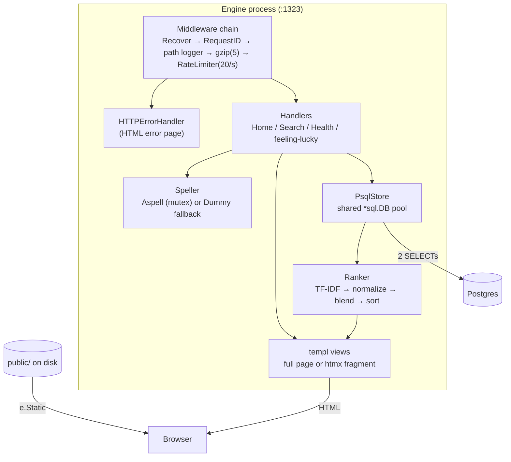
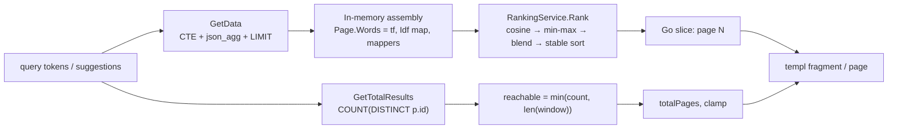

# Engine architecture

**Last updated:** 2026-11-23
**Entry points:** `services/engine/cmd/server/main.go` (HTTP service), `services/engine/cmd/cli/main.go` (local ranking probe)

This page describes how the service is assembled and how a request moves through it. Behavioral contracts live in [HTTP interface](api.md); the SQL and ranking math live in [Implementation](implementation.md).

## Component map



The process is a single Echo server. There are no background workers, no goroutines created by engine code, no message-bus clients, and no cache.

## Startup sequence

`main()` in `services/engine/cmd/server/main.go` runs these steps in order:

1. **Load config** — `config.LoadConfig()` builds a `ranker.RankingConfig` and a `store.StoreConfig` from environment variables. It currently cannot fail; the `log.Fatalf` branch is defensive.
2. **Open the store** — `store.NewStore()` calls `sql.Open`, then pings with a 10-second timeout. `sql.Open` failure **panics**; ping failure calls `log.Fatalln`. Pool limits are applied after a successful ping.
3. **Choose a speller** — `NewAspellSpellingService()` (language hardcoded `en_US`). On any error, it silently swaps in `DummySpeller` (see caveat below).
4. **Build the ranker** — `ranking.NewRankingService(conf.Ranker)`, which only holds the blend weight.
5. **Wire handlers** — `HomeHandler`, `SearchingHandler(store, ranker, speller)`, `HealthHandler`.
6. **Wire Echo** — install the custom `HTTPErrorHandler`, then register middleware, then routes, then `e.Start(":1323")`.

!!! warning "Fail-fast, but no graceful shutdown"
    No database means no server: there is no retry loop, degraded mode, or readiness gate. At the other end, `e.Start` is not wrapped in an `http.Server` with timeouts, and there is no signal handling or graceful drain. `e.Start` errors are logged, not returned to a supervisor.

## Middleware chain

Registered in this exact order in `services/engine/cmd/server/main.go`:

| # | Middleware | Effect |
|---|---|---|
| 1 | `echoMiddleware.Recover()` | Converts panics into errors for the central error handler. |
| 2 | `echoMiddleware.RequestID()` | Adds a request ID to the context; the custom logger does **not** emit it. |
| 3 | Custom path-only logger | Logs `method`, `URL.Path`, `status`, `latency`. Deliberately avoids the stock request logger because it would log the full URI, including search terms. Status defaults to `0` if the response type assertion fails. |
| 4 | `GzipWithConfig(Level: 5)` | Compresses eligible responses. |
| 5 | `RateLimiter(NewRateLimiterMemoryStore(20))` | 20 requests/second per identifier, in-process only. |

!!! danger "Rate-limit identity is client-controlled (review findings H-02, M-26)"
    Echo v5's default identifier extractor is `ctx.RealIP()`. With no `IPExtractor` configured, `RealIP()` reads `X-Forwarded-For`, then `X-Real-IP` from the incoming request. A client can rotate either header to obtain a fresh bucket. The limiter is per-process, so it is not shared across replicas either. The shipped `services/engine/docker-compose.yml` publishes `1323:1323` on all host interfaces, with no reverse proxy in the stack to overwrite those headers.

The search query is absent from both request logs and error logs: the logger uses `URL.Path` only, and the error handler logs `[METHOD] /path → cause`.

## Search request lifecycle

```mermaid
sequenceDiagram
    participant C as Browser / htmx
    participant E as Echo middleware
    participant H as SearchingHandler
    participant SP as Speller
    participant ST as PsqlStore
    participant R as Ranker
    participant V as templ view

    C->>E: GET /search?query=...&tab=...&page=...
    E->>H: after Recover, RequestID, log, gzip, rate limit
    H->>H: queryTokens: trim, ≤200 runes, lower, Fields, ≤10 tokens
    alt tab = images or graph
        H->>V: ShowImages/ShowGraph(nil, isHtmx)
        Note over H,ST: no speller, no DB, no ranker
    else tab = all (default / unknown)
        H->>SP: GetSuggestions(join(tokens, " "))
        SP-->>H: suggestion words (or joined phrase on fallback)
        H->>ST: GetTotalResults(ctx, sugs)
        ST-->>H: count
        H->>ST: GetData(ctx, sugs)
        ST-->>H: Data{pages, idf, mappers}
        H->>R: Rank(data)
        R-->>H: ranked candidate window
        H->>H: reachable = min(len(ranked), count); page math; slice
        H->>V: ShowAll(slice, reachable, totalPages, page, isHtmx)
    end
    V-->>C: full HTML page, or inner #results fragment
```

The two store calls use `c.Request().Context()` but no per-request deadline is set. They are separate statements with no shared transaction, so the advertised count and the fetched rows can disagree under concurrent writes (review finding M-08).

### Tab dispatch

`tab` is read before any expensive work. `images` and `graph` short-circuit to placeholder views; any other value — including an unknown one — falls through to `all`. The default is `all` when `tab` is absent.

### htmx detection

`isHtmx` is `c.Request().Header.Get("HX-Request") == "true"` — an exact, case-sensitive string match. When true, the view emits only the inner tab content; when false, it emits the full layout with a single `#results` container. This invariant is regression-tested in `services/engine/view/page/result/result_test.go`.

## Data flow and ownership



The Engine owns **no data**:

- It reads `words`, `page_word`, `pages`, `urls`, and `page_rank` through two `SELECT`s. It never issues `INSERT`, `UPDATE`, or `DELETE`.
- `words.idf` and `page_word.tf` are read into ranking vectors; `page_rank.score` is read via `LEFT JOIN` and defaults to `0` when absent. Unranked pages stay searchable but sit at the bottom of the PageRank signal — the score is **zero, not a neutral midpoint**.
- `graph_edges` is never referenced. `model.Edge` exists but has no callers.
- No `pages.indexed = TRUE` predicate appears in either query, so any page with `page_word` rows is searchable regardless of index state.
- No data is cached: no Redis client, memoization, ETag, or `Cache-Control` header exists in the service.

## Concurrency, timeouts, and failure handling

| Concern | Implemented behavior |
|---|---|
| Database pool | One shared `*sql.DB`; `PG_MAX_OPEN_CONNS` / `PG_MAX_IDLE_CONNS` (defaults 20/20). |
| Aspell | One shared speller serialized by a `*sync.Mutex` (zero-value spellers use a package-level fallback mutex). Safe under `-race`, but a throughput bottleneck. |
| Ranker | Stateless; local slices/maps only. |
| Timeouts | Boot ping 10s; DSN `connect_timeout=5`, `statement_timeout=30000`; CLI `GetData` 5s. No HTTP-side deadline and no timeout around aspell calls. |
| Panics by design | Mapper inconsistencies in `tf-idf.go` / `util.go` panic; `Recover()` converts request-time panics into 500s. `sql.Open` failure panics at boot, before middleware exists. |
| Errors | Store and ranker wrap causes as `apperror.Internal`; `HandleError` classifies them into an HTML page and logs only the internal cause. |

See [Implementation](implementation.md) for the exact error-classification table and SQL text.

## External dependencies

| Dependency | Version / source | Role |
|---|---|---|
| `github.com/labstack/echo/v5` | v5.0.4 | HTTP server, middleware, routing |
| `github.com/lib/pq` | v1.11.2 | Postgres driver; registers `postgres` and provides `pq.Array` |
| `github.com/trustmaster/go-aspell` | pseudo-version | cgo binding to aspell for suggestions |
| `github.com/google/uuid` | v1.6.0 | Page identity and deterministic sort key |
| `github.com/a-h/templ` | v0.3.1020 | Compile-time HTML templates |
| Aspell + `aspell-en` | runtime OS package | Dictionary behind go-aspell; language hardcoded `en_US` |
| htmx / Alpine 3 / Tailwind 4 | npm devDependencies | Browser interaction and CSS; bundled into `public/` |

## Related pages

- [Engine overview](index.md)
- [HTTP interface](api.md)
- [Implementation](implementation.md)
- [Configuration](configuration.md)
