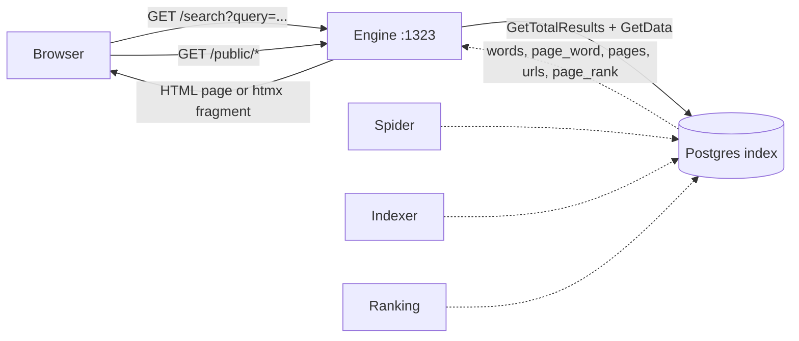

# Engine service

The Engine is the Boogle service that turns the shared Postgres index into the search web UI. It is a **read-only** consumer: it queries the index and renders HTML. It writes no tables, publishes no queue messages, and keeps no cache or session state.

**Last updated:** 2026-11-23

## At a glance

| Property | Value |
|---|---|
| Language | Go 1.27.1 (`services/engine/go.mod`) |
| HTTP framework | Echo v5 (`github.com/labstack/echo/v5`, v5.0.4) |
| Server entry point | `services/engine/cmd/server/main.go` → binary `boogle` |
| Debug entry point | `services/engine/cmd/cli/main.go` (local only; not built into the image) |
| Listen address | `:1323`, all interfaces |
| View layer | templ v0.3.1020 (server), htmx 2 + Alpine 3 (browser) |
| Datastore | Postgres via `lib/pq`; two parameterized `SELECT`s per search |
| Process model | Stateless HTTP; in-process rate limiting; one shared aspell instance behind a mutex |

## Role in the system



Spider, Indexer, and Ranking own the data pipeline that fills Postgres. The Engine only reads the result. It does **not** compute IDF or PageRank, does not inspect `graph_edges`, and applies no `pages.indexed` filter — see [Architecture](architecture.md) and [Implementation](implementation.md).

## What it serves

| Route | Purpose |
|---|---|
| `GET /` | Search home page |
| `GET /search` | Search results (`all`), or placeholder tabs (`images`, `graph`) |
| `GET /health` | Static JSON liveness probe |
| `GET /feeling-lucky` | Hard-coded text response |
| `GET /public/*` | Static CSS/JS/fonts from disk |

Full request and response contracts are in [HTTP interface](api.md).

## Request path, in one paragraph

A request passes panic recovery, request ID, a path-only logger, gzip (level 5), and an in-process rate limiter. `GET /search` normalizes `query` to at most 10 lower-case tokens, expands them through the spellchecker, issues a count query and a candidate query, ranks the candidate window in memory (min–max-normalized TF-IDF blended with raw PageRank), and slices one page of results. The handler renders either a full templ page or an htmx fragment, depending on the exact `HX-Request: true` header. See [Architecture](architecture.md) for the sequence diagram.

## Caveats at a glance

!!! warning "Read before operating"
    - **Aspell fallback is degraded.** If spellchecker init fails, a dummy speller returns the joined query phrase as one token, so multi-word searches normally return nothing. (review finding H-03; confirmed in code)
    - **Only abuse control is spoofable.** The Echo rate limiter keys on `RealIP()`, which trusts `X-Forwarded-For`/`X-Real-IP`; the container publishes `1323:1323` on all host interfaces. (review findings H-02, M-26)
    - **`/health` is DB-agnostic.** It always returns `{"status":"ok"}`; a dead database does not fail the Docker healthcheck. (review finding M-06)
    - **No `/metrics` endpoint.** No metrics, tracing, or analytics are emitted by the service.
    - **Images and Graph tabs are placeholders.** Both always render "no results" and skip the speller, store, and ranker.
    - **Assets are served from disk.** `public/` is a generated, gitignored directory; there is no `go:embed` despite an unused `embed.FS` declaration. (review finding L-07)

Accessibility gaps (unlabeled inputs and icon buttons, tab and pagination keyboard issues, missing live region, low-contrast inactive tabs, hardcoded error timestamp) are catalogued in [Implementation](implementation.md).

## Data ownership

| Table / artifact | Engine access |
|---|---|
| `words`, `page_word`, `pages`, `urls` | `SELECT` only (candidate query and count query) |
| `page_rank` | `SELECT` only via `LEFT JOIN`; missing row becomes score `0` |
| `graph_edges` | Never referenced; `model.Edge` exists but is unused |
| `public/` assets | Read from disk at request time; generated, not committed |
| `words.idf`, `page_word.tf` | Read to build ranking vectors; never written |

The Engine's corpus definition differs from the ranking service's: it applies no `indexed` filter. That is an engine-side fact verified from SQL; the cross-service consequence is outside this page's scope.

## Run it locally

Commands below come from `services/engine/justfile` and the verified fact sheet; the Go process does **not** load `.env` files itself.

```bash
cd services/engine
npm install
just templ-generate && just tailwind-build && just js-build   # or: just dev (also runs air)
go run ./cmd/server                                            # http://localhost:1323
just cli "search terms"                                        # ranking probe without HTTP
```

Full recipes, environment variables, container setup, and caveats are in [Configuration](configuration.md).

## Page index

- [Architecture](architecture.md) — startup, middleware, request lifecycle, data flow
- [HTTP interface](api.md) — routes, parameters, responses, errors
- [Implementation](implementation.md) — SQL, ranking math, rendering, tests, limitations
- [Configuration](configuration.md) — environment variables, fallbacks, container setup

!!! note "Review finding IDs"
    IDs such as H-03 above refer to the 2026-11-22 project review and are included only as supporting context where current code confirms the behavior. They are not an independent source of truth.
