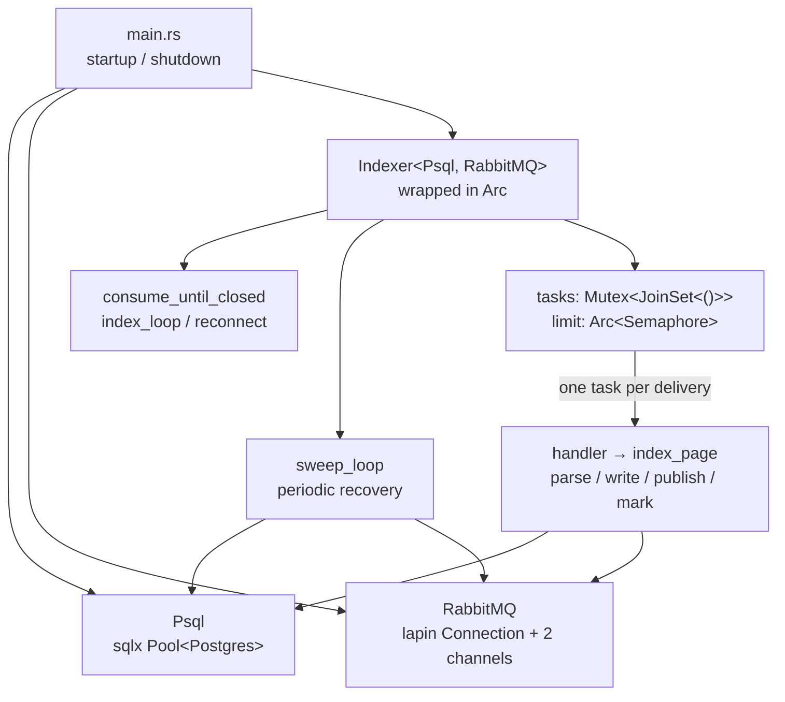

# Architecture

This page describes how the Indexer process is put together: startup, shared clients, task concurrency, shutdown, and failure handling. The data flow for one page is covered in [Indexing pipeline](indexing-pipeline.md); environment values are in [Configuration](configuration.md).

## Components



The module layout is flat within `services/indexer/src/core/`: `config.rs`, `errors.rs`, `indexer.rs`, `messaging.rs`, `psql.rs`, `text_sink.rs`, `utils.rs` (`services/indexer/src/core/mod.rs`).

`DB` (`services/indexer/src/core/psql.rs`) and `MessagingQueue` (`services/indexer/src/core/messaging.rs`) are traits. Production uses `Psql` and `RabbitMQ`; unit tests use in-memory mocks. `Indexe` in `indexer.rs` is the lifecycle trait (`start`, `sweep_loop`, `close`) — the name is a typo in the source, not a separate component.

## Startup order

`main` is `#[tokio::main]` and proceeds in this order (`services/indexer/src/main.rs`):

1. `load_config(".env")` reads a `.env` relative to the **process working directory**. A missing/unreadable file logs a warning to stderr and continues with process environment.
2. `init_logger(LOG_PATH)` creates parent directories, opens the log file append-only, and builds a duplicated colored-stderr + JSON-file async logger with the fixed field `service=indexer` (`services/indexer/src/core/utils.rs`).
3. `Psql::new` builds the pool, applies startup options on every connection, and runs a `SELECT 1 + 1 as sum` readiness query.
4. `RabbitMQ::new` dials the broker, creates an ordinary channel and a confirm channel, enables `confirm_select`, and declares both configured queues.
5. `Indexer::new` wraps the clients in `Arc` and creates the task `JoinSet` and `Semaphore`.
6. Three Tokio tasks are spawned: `indx.start(token)`, `indx.sweep_loop(token)`, and a Ctrl-C listener that cancels the token.

Startup database or broker failures are fatal: they return from `Psql::new`/`RabbitMQ::new` before the loops exist.

## Shared clients

### PostgreSQL

| Aspect | Implemented behavior | Source |
|---|---|---|
| Pool sizing | `max_connections`, `min_connections`, `acquire_timeout` from config | `services/indexer/src/core/psql.rs` |
| Startup options | `application_name=boogle-indexer`, `lock_timeout`, `statement_timeout`, fixed `idle_in_transaction_session_timeout=30000` (ms) on every pooled connection | `services/indexer/src/core/psql.rs` |
| Readiness | `SELECT 1 + 1 as sum` after pool creation | `services/indexer/src/core/psql.rs` |
| SQL style | sqlx macros for most statements (offline metadata under `services/indexer/.sqlx`); the claim query uses `query_as` with `.bind(...)`. All production SQL uses bound parameters | `services/indexer/src/core/psql.rs` |

!!! note "Shared pool, not per-worker connections"
    Every indexing task calls the same `Arc<Psql>` pool. There is no per-worker dedicated connection and no per-worker state; tasks share the pool, the `Arc<RabbitMQ>` client, the `JoinSet`, and the semaphore.

### RabbitMQ

| Aspect | Implemented behavior |
|---|---|
| Connection | `ConnectionProperties::default().enable_auto_recover()`, plus an explicit re-dial in `channels()` when `conn.status().connected()` is false |
| Channels | `ch` for consume/plain publish and QoS; `confirm_ch` with `confirm_select` enabled for confirmed publish |
| Declarations | Both `RABBITMQ_QUEUE` and `RABBITMQ_CONFIRMATION_QUEUE` are declared durable with default arguments at connect time (and again after reconnect) |
| Exchange | None declared. Both publish paths use the default exchange `""` with the queue name as routing key |
| Recovery | QoS/consume channel errors call `force_reconnect()` even if the connection reports connected; consumer stream end/error returns to `index_loop`, which reconnects with backoff from 1 s doubling to 30 s |

Both messages are persistent (`delivery_mode = 2`) with `content_type = application/json`. Confirmed publish sets `mandatory: true` and awaits the broker; the sweep's plain publish sets neither confirms nor mandatory. See [Message paths](indexing-pipeline.md#message-paths).

## Concurrency and work ownership

- `Indexer.tasks: Mutex<JoinSet<()>>` holds spawned work; `Indexer.limit: Arc<Semaphore>` caps it (`services/indexer/src/core/indexer.rs`).
- Each delivery races permit acquisition against cancellation. The permit is held for the task's lifetime, so at most `PG_MAX_CONNECTIONS` pages are being indexed at once.
- The consumer sets basic QoS/prefetch to the same value. The prefetch is cast to `u16` in `consume()`.
- Completed tasks are reaped with `try_join_next()` inside the consume loop; remaining tasks are joined during shutdown.

!!! warning "One knob, three limits"
    `PG_MAX_CONNECTIONS` sets the Postgres pool max, the task semaphore size, and the AMQP prefetch. Values above 65535 do not mean what the name suggests for prefetch because of the `u16` cast. See [Configuration](configuration.md#pg_max_connections-is-overloaded).

## Lifecycle and shutdown

```mermaid
sequenceDiagram
    participant OS as OS / operator
    participant Main as main
    participant Signal as ctrl_c task
    participant Token as CancellationToken
    participant Consumer as index_loop
    participant Sweep as sweep_loop
    participant Tasks as JoinSet tasks

    Main->>Consumer: spawn start(token)
    Main->>Sweep: spawn sweep_loop(token)
    Main->>Signal: spawn ctrl_c listener
    OS->>Signal: Ctrl-C
    Signal->>Token: cancel()
    Token-->>Consumer: stop taking deliveries
    Token-->>Sweep: stop ticking
    Main->>Consumer: await loop handle
    Main->>Sweep: await loop handle
    Main->>Tasks: await up to 30 s
    Main->>Main: close RabbitMQ + PostgreSQL; exit 1 if had_error
```

`start()` also cancels the token whenever `index_loop` exits. A failure of the sweep task's `JoinHandle` (not a logged sweep error) calls `process::exit(1)` immediately. The indexer loop's typed or panic error is logged and results in exit code 1 after cleanup.

!!! warning "Only Ctrl-C is handled"
    `tokio::signal::ctrl_c()` is the sole signal listener (`services/indexer/src/main.rs`); **SIGTERM is not handled**. The Docker entrypoint ends with `exec ./indexer`, making the binary PID 1, so `docker stop` sends SIGTERM to a process with no handler. The graceful path described above is not taken in that case.

!!! warning "The 30 s drain is a timeout"
    After the timeout, main logs `still_running` and proceeds to `close()` the MQ and DB clients. Tasks are neither cancelled nor killed. Do not read the 30 s window as "all in-flight work always finishes."

!!! danger "Panics abort in release builds"
    `services/indexer/Cargo.toml` sets `panic = "abort"` for the release profile. A panic in a worker task is not converted into a `JoinSet` error — the whole process aborts, and the attempt counter was already incremented at claim time.

## Failure handling

Error types are `DatabaseError`, `MessagingError`, and `IndexerError` (aliased as `AppError`) in `services/indexer/src/core/errors.rs`, with conversions from sqlx, lapin, serde_json, `String`, and `io::Error`.

### Requeue policy

`should_requeue(&AppError)` in `services/indexer/src/core/indexer.rs` decides the AMQP NACK:

| Error class | Requeue? | Rationale |
|---|---|---|
| `Database` except `NotFoundError` | Yes | Transient/db-wide conditions may clear |
| `Messaging` (all variants) | Yes | Broker recovery is expected |
| `Other` | Yes | Treated as potentially transient |
| `SerdeError` | No | A malformed payload will never parse |
| `ParseError` | No | A parse failure is treated as permanent for that delivery |
| `Database::NotFoundError` | No | Page missing, already claimed, or over budget |

ACK/NACK failures themselves are only logged. A failed ACK can cause duplicate processing; the claim guards reduce duplicate database writes, but duplicate confirmations are possible.

!!! note "Poison messages are not quarantined"
    There is no dead-letter exchange. Dropped (`requeue=false`) messages leave the queue, but a `ParseError` still calls `release_claim()`, which clears the page claim and its `page_word` rows. After `SWEEP_GRACE_SECONDS`, the sweep can republish the same page as a fresh job. "Not requeued" is not the same as "never seen again."

### Retry helpers

`retry_async` and `retry_sync` (`services/indexer/src/core/utils.rs`) count **total attempts** (3 means at most 3 calls), assert a minimum of one, and sleep a fixed 500 ms between attempts.

!!! warning "No backoff or jitter"
    The flat 500 ms delay is suitable for a restarted connection but not sustained overload; the source comment says as much. These helpers are used for consumer startup, sweep publish, per-page word writes, confirmation serialization/publish, and (in the blocking form) confirmation serialization.

## Data ownership

| Table / columns | Indexer writes | Indexer reads | Notes |
|---|---|---|---|
| `pages` | `indexed`, `indexed_at`, `last_index_attempt_at`, `index_attempts` | `id`, `url_id`, `html`, `updated_at`, attempt columns | Claim sets a NULL `indexed_at`; completion sets it and resets attempts; `FOR UPDATE SKIP LOCKED` makes replicas safe |
| `words` | `word` via `INSERT ... ON CONFLICT DO NOTHING` | `id` by word | `idf` defaults to 1 and `doc_frequency` to 0; Ranking recomputes `idf` in `services/ranking/src/calculator.py` |
| `page_word` | Full delete + batched inserts of `(page_id, word_id, tf)`; also deleted on release/stale reclaim | — | `tf` is the raw integer token count, not a normalized ratio |
| `graph_edges`, `page_rank` | — | — | Owned by Spider and Ranking respectively |

Schema support lives in `migration/01_schema.sql` and `migration/03_index_completion.sql` (completion marker, partial indexes, and a one-time backfill).

## Deployment notes

| Topic | Verified behavior |
|---|---|
| Local build | `RUSTFLAGS="-C target-cpu=native" cargo build --release` (`services/indexer/justfile`) |
| Docker build | `SQLX_OFFLINE=true`, `RUSTFLAGS="-C target-cpu=x86-64-v2"`, musl target (`services/indexer/Dockerfile`) |
| Runtime image | Alpine, non-root UID/GID 10001, `/app/logs` owned by app user, `exec ./indexer` (`services/indexer/entrypoint.sh`) |
| Compose | `restart: unless-stopped`, external `search_net` (`services/indexer/docker-compose.yml`) |
| Healthcheck | `pidof indexer` only — it does not check database or broker health (`services/indexer/Dockerfile`) |

## Related pages

- [Overview](index.md) — responsibilities and source map
- [Indexing pipeline](indexing-pipeline.md) — claim, parse, write, confirm, sweep
- [Configuration](configuration.md) — environment variables and defaults
