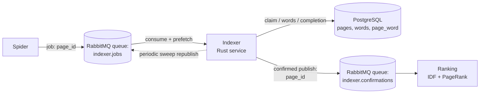

# Indexer

The Indexer is the second stage of the Boogle pipeline. It consumes crawl jobs from RabbitMQ, turns stored HTML into word–count rows in PostgreSQL, and publishes a confirmation that lets Ranking recompute IDF and PageRank.

This page is an overview. See [Architecture](architecture.md) for process and client design, [Indexing pipeline](indexing-pipeline.md) for the per-page flow and wire contracts, and [Configuration](configuration.md) for every environment variable.

!!! note "Source of truth"
    These pages describe the code in `services/indexer/src/`, `services/indexer/Cargo.toml`, `services/indexer/entrypoint.sh`, and `migration/`. Older prose in `docs/INDEXER.md` and `services/indexer/README.md` contains claims that no longer match the code; the code wins.

## At a glance

| Property | Implemented behavior |
|---|---|
| Language / build | Rust 2024 binary using Tokio, sqlx/Postgres, lapin/RabbitMQ, html5ever, slog (`services/indexer/Cargo.toml`) |
| Input | `{"page_id":"<uuid>"}` jobs on the queue named by `RABBITMQ_QUEUE` (default `indexer.jobs`) |
| Output | `words` and `page_word` rows plus one `{"page_id":"<uuid>"}` confirmation on `RABBITMQ_CONFIRMATION_QUEUE` (default `indexer.confirmations`) |
| Concurrency | One Tokio task per delivery, gated by a `Semaphore`; the same value sets pool size and AMQP prefetch |
| Delivery semantics | At-least-once: ACK after success, NACK with requeue decided by error class |
| Crash recovery | Reconciliation sweep over stale `pages.indexed_at IS NULL` claims, plus normal requeue of unacked messages |
| Tests | Inline `#[cfg(test)]` modules for unit behavior; live-Postgres tests are `#[ignore]`d |

## Role in the system



The Spider publishes jobs with publisher confirms; Ranking consumes the confirmation body's `page_id`. Queue names are configuration, so all three services must agree on them. See [Indexing pipeline](indexing-pipeline.md#wire-contract) for the exact messages.

## What the Indexer owns

| Area | Indexer behavior | Owner elsewhere |
|---|---|---|
| `pages.indexed`, `pages.indexed_at`, `pages.last_index_attempt_at`, `pages.index_attempts` | Written by claim, completion, release, and sweep SQL | Spider creates the page rows and writes `html`/`metadata` |
| `words` | Inserts `word` rows only (`INSERT ... ON CONFLICT DO NOTHING`) | Ranking recomputes `idf` (`services/ranking/src/calculator.py`); `doc_frequency` keeps its schema default here |
| `page_word` | Deletes and rewrites the whole term set for a page; `tf` is a **raw integer count** | Ranking reads `tf` as input to scoring |
| `graph_edges`, `page_rank` | Not touched | Spider writes edges; Ranking writes scores |
| Queues | Declares both job and confirmation queues durable; consumes jobs, publishes confirmations and sweep jobs | Spider publishes jobs; Ranking consumes confirmations |

!!! warning "`tf` is a count, not a ratio"
    `page_word.tf` is the number of times a token occurs on the page, cast to `i32` (`services/indexer/src/core/psql.rs`). It is not normalized by page length. There is no stemming step; tokens are lowercased and filtered as described in [Tokenization](indexing-pipeline.md#step-2-parse-and-tokenize).

## Lifecycle summary

1. `main` loads `.env` relative to the process working directory, initializes a JSON-file-plus-stderr logger, then constructs the PostgreSQL pool and RabbitMQ client. Connection failures here are fatal.
2. Two loops are spawned: the consumer (`start`/`index_loop`) and the periodic `sweep_loop`. A third task waits for **Ctrl-C** and cancels the shared token.
3. Each delivery spawns a task that claims the page, parses HTML, writes word rows transactionally, publishes a confirmed confirmation, marks the page complete, and ACKs. Failures release the claim and NACK according to the error class.
4. On cancellation the consumer stops taking deliveries, the service waits up to 30 s for its task set to drain, closes RabbitMQ and PostgreSQL, and exits non-zero if the indexer loop reported an error.

!!! warning "Shutdown caveats"
    Only `tokio::signal::ctrl_c()` is listened to — **there is no SIGTERM handler** (`services/indexer/src/main.rs`). Because the Docker entrypoint `exec`s the binary as PID 1, `docker stop` does not trigger this path. The 30 s drain is a timeout, not a guarantee: tasks are not cancelled or killed, and connections are closed after it expires.

## Reliability model

- Requeue: database errors other than `NotFoundError`, all messaging errors, and `Other`.
- Drop: `SerdeError`, `ParseError`, and `DatabaseError::NotFoundError`.
- Dropped jobs are **not** permanently quarantined: a parse failure releases the page claim, so the sweep can republish the page after the grace period. No dead-letter exchange is configured.
- Retries use a fixed 500 ms delay with no backoff or jitter, and there are three independent attempt budgets. See [Failure handling](architecture.md#failure-handling) and [Attempt budgets](configuration.md#attempt-budgets).

## Source map

| File | Responsibility |
|---|---|
| `services/indexer/src/main.rs` | Startup, task spawning, signal handling, shutdown sequence |
| `services/indexer/src/core/config.rs` | Environment loading, defaults, sanitization |
| `services/indexer/src/core/indexer.rs` | Consumer loop, per-page flow, sweep loop, requeue policy |
| `services/indexer/src/core/psql.rs` | `DB` trait and sqlx implementation: claim, word writes, completion, release, sweep |
| `services/indexer/src/core/messaging.rs` | `MessagingQueue` trait and lapin client, message types, wire shape |
| `services/indexer/src/core/text_sink.rs` | html5ever `TreeSink` tokenization |
| `services/indexer/src/core/errors.rs` | Typed error envelopes (`AppError = IndexerError`) |
| `services/indexer/src/core/utils.rs` | Logger setup and fixed-delay retry helpers |

## Verify locally

Commands come from `services/indexer/justfile`:

```bash
cd services/indexer
cargo test                          # fast unit tests, no live services
cargo test -- --ignored --nocapture # live PostgreSQL tests
cargo llvm-cov --summary-only || cargo test
```

Local release builds use `RUSTFLAGS="-C target-cpu=native" cargo build --release`; the Docker image builds with `SQLX_OFFLINE=true` and `-C target-cpu=x86-64-v2`. Release profiles set `panic = "abort"`, so a panic in any task aborts the process rather than unwinding into `JoinSet`.
