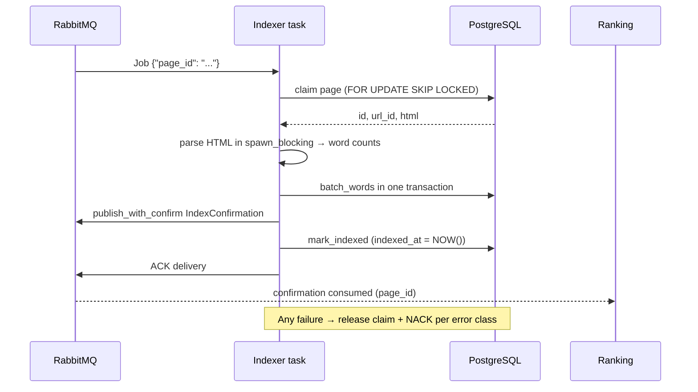
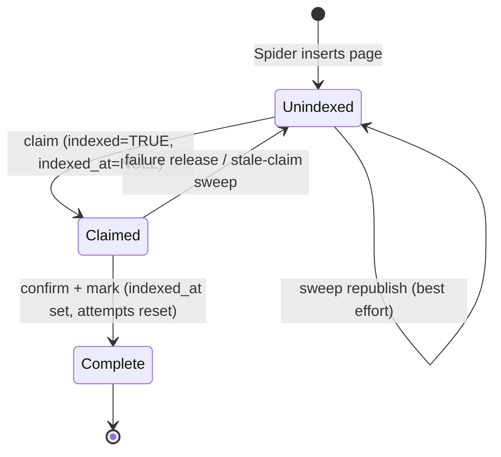

# Indexing pipeline

This page follows one job from the RabbitMQ queue to the completion marker, then describes the reconciliation sweep that recovers work from crashed claims. Source of truth: `services/indexer/src/core/indexer.rs`, `services/indexer/src/core/psql.rs`, and `services/indexer/src/core/text_sink.rs`.

## End-to-end flow



The consumer takes one delivery, acquires a semaphore permit, and spawns a task (see [Architecture](architecture.md#concurrency-and-work-ownership)). `handler()` deserializes the `Job`, calls `get_page_by_id(...)`, then `index_page(...)`.

## Wire contract

Both message types have the same shape (`services/indexer/src/core/messaging.rs`):

```json
{"page_id":"6f8c3c3c-1b1a-4b2e-9f3d-2c4e5f6a7b8c"}
```

| Contract point | Implemented behavior |
|---|---|
| Job input | `Job { page_id: Uuid }` on `RABBITMQ_QUEUE` (default `indexer.jobs`), published by Spider |
| Confirmation output | `IndexConfirmation { page_id: Uuid }` on `RABBITMQ_CONFIRMATION_QUEUE` (default `indexer.confirmations`), consumed by Ranking via `body["page_id"]` |
| Extra fields | Tolerated on incoming jobs (serde ignores unknown fields) |
| Rejected input | Malformed JSON, missing/wrong-typed `page_id`, empty string, and non-UUID values produce `SerdeError` |
| Exchange | None declared; default exchange `""` with the queue name as routing key |
| Properties | Persistent (`delivery_mode = 2`) and `content_type = application/json` |

### Message paths

| Path | Method | Guarantees |
|---|---|---|
| Confirmation to Ranking | `publish_with_confirm()` | `mandatory: true`, awaits broker confirmation; unroutable/NACK replies are errors. `Confirmation::NotRequested` is treated as success |
| Sweep job republish | `publish()` | Plain `basic_publish` with persistence; **no confirms and no mandatory flag** |
| Job consumption | `consume()` | Sets QoS/prefetch to the configured concurrency; ACK/NACK per delivery |

!!! note "Queue declarations"
    The Indexer declares **both** queues durable with default arguments on connect and reconnect. Queue names come from configuration and must match Spider and Ranking.

## Step 1 — Claim the page

The claim is a single statement with `FOR UPDATE SKIP LOCKED`, so multiple replicas take different rows (`services/indexer/src/core/psql.rs`):

```sql
WITH cte AS (
  SELECT id, url_id, html
  FROM pages
  WHERE indexed = FALSE
    AND id = $1
    AND index_attempts < $2
  FOR UPDATE SKIP LOCKED
  LIMIT 1
)
UPDATE pages
SET indexed = TRUE,
    indexed_at = NULL,
    last_index_attempt_at = NOW(),
    index_attempts = pages.index_attempts + 1
FROM cte
WHERE pages.id = cte.id
RETURNING pages.id, pages.url_id, pages.html
```

- `indexed = TRUE` means *claimed*, not *finished*; `indexed_at IS NULL` distinguishes an open claim.
- `index_attempts` is incremented **at claim time**, including deliveries that later abort. In release builds `panic = "abort"` prevents a failure path from running, but the committed claim still counts.
- Missing, already-claimed, or over-budget pages yield `DatabaseError::NotFoundError`.

`$2` is `MAX_INDEX_ATTEMPTS`. This is the page-level budget, distinct from retry counts — see [Attempt budgets](configuration.md#attempt-budgets).

## Step 2 — Parse and tokenize

`index_page()` moves HTML into `tokio::task::spawn_blocking` and calls `parse()` from `services/indexer/src/core/text_sink.rs`. The parser feeds html5ever into a `TreeSink` that keeps only word counts, avoiding the word-joining problem of stripping tags.

| Rule | Behavior |
|---|---|
| Text source | `parse_document(...).from_utf8()`; no character-set detection is performed |
| Ignored elements | Text under `script` and `style` parents is skipped; comments contribute nothing |
| Boundaries | Elements set a boundary so adjacent text runs (e.g. `<p>alpha</p><p>beta</p>`) stay separate |
| Chunk splicing | A trailing partial word is held in `pending` and rejoined with the next chunk; tests cover inline markup such as `<b>ex</b>ample` and long runs |
| Punctuation | Trims leading/trailing `. , : / ; " ' ! ? ( ) [ ]` |
| Filter | Drops tokens containing any non-alphabetic character (numbers, hyphens) |
| Case | Lowercases before counting; no stemming is applied |
| Occurrences | Returns a `HashMap<String, u32>` of raw counts |

`char::is_alphabetic` accepts Unicode letters: tests assert `naïve` and `café` are indexed. Tokenization is therefore not English-only in the sense of rejecting non-ASCII letters.

## Step 3 — Write the word index

`batch_words()` (`services/indexer/src/core/psql.rs`) replaces a page's whole term set in one transaction. A failure aborts the transaction and leaves the previous index intact; `index_page()` retries the entire write.

1. Empty result (or all tokens over the length cap) replaces the page's `page_word` rows with an empty set in a separate transaction. This clears stale terms on re-crawl.
2. Tokens longer than `MAX_WORD_LEN = 25` characters are dropped, matching `words.word VARCHAR(25)`.
3. The old rows are deleted, then words are upserted in chunks of `WORD_BATCH_SIZE`:

   ```sql
   DELETE FROM page_word WHERE page_id = $1;

   INSERT INTO words (word)
   SELECT * FROM UNNEST($1::text[])
   ON CONFLICT (word) DO NOTHING;

   SELECT id, word FROM words WHERE word = ANY($1);
   ```

4. If resolved word IDs do not cover every storable token, the transaction errors instead of partially indexing the page.
5. Links are inserted in chunks of `PAGE_WORD_BATCH_SIZE`:

   ```sql
   INSERT INTO page_word (page_id, word_id, tf)
   SELECT $1, * FROM UNNEST($2::uuid[], $3::int4[])
   ON CONFLICT (page_id, word_id) DO UPDATE SET tf = EXCLUDED.tf;
   ```

6. `tx.commit()` finishes the write.

!!! warning "`tf` is a raw integer count"
    `tf` is the token's occurrence count cast to `i32` and stored directly (`services/indexer/src/core/psql.rs`, `migration/01_schema.sql`). It is **not** `count / total_words` or any other normalized ratio. There is no normalization step in this service.

`words.idf` and `words.doc_frequency` are not written here; they keep their schema defaults until Ranking recomputes `idf` (`services/ranking/src/calculator.py`).

## Step 4 — Confirm, then mark complete

The confirmation is serialized and published **before** the completion marker. The two writes cannot share a transaction; a missing confirmation starves Ranking while a duplicate confirmation is harmless (`services/indexer/src/core/indexer.rs`).

```json
{"page_id":"6f8c3c3c-1b1a-4b2e-9f3d-2c4e5f6a7b8c"}
```

- Serialization uses `retry_sync(max_retries.max(1))`; the publisher uses `retry_async(max_retries.max(1))` with `publish_with_confirm()`.
- A publish or serialization failure releases the claim and returns the error, so the job can be requeued.
- Completion is a single un-retried statement (`services/indexer/src/core/psql.rs`):

  ```sql
  UPDATE pages
  SET indexed_at = NOW(),
      last_index_attempt_at = NULL,
      index_attempts = 0
  WHERE id = $1 AND indexed = TRUE AND indexed_at IS NULL
  ```

  Zero affected rows produce `NotFoundError`. The `indexed_at IS NULL` guard prevents a late worker from re-stamping a newer claim, and resetting `index_attempts` makes the budget per indexing episode.

Only after all of the above succeeds does the delivery get ACKed.

## Step 5 — Failure and claim release

Every parse, write, publish, or mark failure calls `release_claim()`, which invokes `undo_indexing()` but logs (rather than replaces) the original error so the requeue decision keeps the right error class (`services/indexer/src/core/indexer.rs`).

```sql
WITH released AS (
   UPDATE pages
   SET indexed = FALSE,
       indexed_at = NULL,
       last_index_attempt_at = NOW()
   WHERE id = $1 AND indexed_at IS NULL
   RETURNING id
)
DELETE FROM page_word pw
USING released
WHERE pw.page_id = released.id
```

This is one transaction: the claim and its partial word rows are released together, and a page already completed by another worker is left alone. It does **not** increment `index_attempts` (the claim already did). The delivery is then NACKed with `requeue = should_requeue(&err)`:

| Requeued | Dropped (`requeue=false`) |
|---|---|
| Database errors except `NotFoundError`, all messaging errors, `Other` | `SerdeError`, `ParseError`, `DatabaseError::NotFoundError` |

!!! note "Not a permanent quarantine"
    Dropped messages are not dead-lettered by this service. A parse error releases the page claim, so after `SWEEP_GRACE_SECONDS` the sweep can republish the same page. See [Failure handling](architecture.md#failure-handling).

## Reconciliation sweep

`sweep_loop()` starts after the first interval (not immediately) and stops on cancellation (`services/indexer/src/core/indexer.rs`). Each tick calls `get_stale_unindexed()`, which runs two statements (`services/indexer/src/core/psql.rs`):

```sql
-- 1. Release stale open claims and delete their partial words.
WITH released AS (
    UPDATE pages
    SET indexed = FALSE, last_index_attempt_at = NULL
    WHERE indexed = TRUE
      AND indexed_at IS NULL
      AND last_index_attempt_at IS NOT NULL
      AND last_index_attempt_at < NOW() - make_interval(secs => $1)
      AND index_attempts < $2
    RETURNING id
)
DELETE FROM page_word pw USING released WHERE pw.page_id = released.id;

-- 2. Select pages eligible for a fresh job.
SELECT id FROM pages
WHERE indexed = FALSE
  AND updated_at < NOW() - make_interval(secs => $1)
  AND (last_index_attempt_at IS NULL
       OR last_index_attempt_at < NOW() - make_interval(secs => $1))
  AND index_attempts < $3
ORDER BY updated_at ASC
LIMIT $2;
```

For each returned ID, the service serializes a `Job` and republishes it to `RABBITMQ_QUEUE` with `retry_async(MAX_ATTEMPTS, ...)` (the fixed constant 3, not `MAX_RETRIES`). Query, serialization, and publish failures are logged and do not stop the loop.

!!! warning "Sweep republish is best-effort"
    The sweep uses plain `publish()` — no broker confirm, no mandatory flag — **after** the release statement has already cleared the claim and deleted partial words. A lost republish leaves the page unclaimed but without a queued job until a later sweep tick picks it up again. It is a recovery aid, not a guaranteed delivery mechanism.

Schema support (completion marker, partial indexes for open claims and unindexed pages, and a one-time backfill) is in `migration/03_index_completion.sql`.

## Page state



## Tests and verification

Unit tests cover the page flow, poison policy, sweep, serialization, retries, tokenization edge cases, and configuration (`#[cfg(test)]` modules in `services/indexer/src/core/`). Live-database tests are `#[ignore]`d. From `services/indexer/`:

```bash
cargo test
cargo test -- --ignored --nocapture
```
