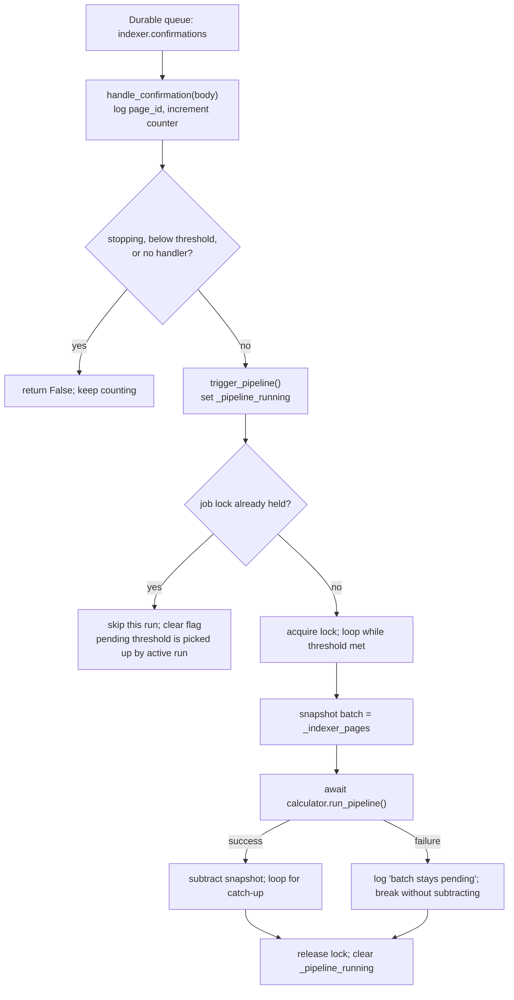

# Architecture

This page describes the implemented runtime of the ranking service: how it starts, how confirmations become pipeline runs, and what happens on failure. All references point into `services/ranking/src/` unless stated otherwise.

## Module map

| Module | Role |
|---|---|
| `services/ranking/src/main.py` | Entry point, JSON logging, environment validation, DB retry, service lifecycle |
| `services/ranking/src/calculator.py` | IDF SQL, PageRank call, concurrent `run_pipeline()` |
| `services/ranking/src/messaging.py` | Broker URL assembly, confirmation subscriber, batching lock, drain |
| `services/ranking/src/psql.py` | `DatabaseManager` pool, DSN construction, retry decorator |

`RankingService.__init__` eagerly constructs the database manager (pool sizes `2`/`10`), the calculator, and the messaging service. Because `MessagingService` resolves the broker URL in its constructor, broker configuration must be resolvable **before** `start()` runs its validation; a failure there propagates to `main()` and exits nonzero.

## Startup lifecycle

```mermaid
sequenceDiagram
    participant M as main()
    participant S as RankingService
    participant D as DatabaseManager
    participant Q as MessagingService
    participant C as FastStream consumer

    M->>S: construct (db + calculator + messaging)
    M->>S: start()
    S->>S: configure_logging(); load_dotenv()
    S->>S: validate_environment()
    S->>D: initialize() — 5-attempt retry
    S->>Q: register_pipeline_handler(calculator.run_pipeline)
    opt RANKING_RUN_ON_STARTUP enabled (default)
        S->>Q: trigger_pipeline(force=True)
    end
    S->>C: await run()
    C-->>S: return / signal
    S->>Q: drain()
    S->>D: close()
```

Startup details:

1. `main()` loads `.env`, constructs the service, configures logging, and runs `service.start()` under `asyncio.run()`. `start()` calls `load_dotenv()` again before validation.
2. `validate_environment()` requires either `DATABASE_URL` or all five `PG_*` variables, and either a broker URL or resolvable RabbitMQ credentials.
3. `_initialize_db_with_retry()` attempts to open the pool **5 times**, waiting `1, 2, 4, 8` seconds between attempts (delay capped at 30). `AsyncConnectionPool.open(wait=True)` makes a bad DSN fatal at boot.
4. The pipeline handler is registered on the messaging service.
5. If `RANKING_RUN_ON_STARTUP` is not `0`, `false`, or `no` (after strip/lower), `trigger_pipeline(force=True)` starts one pass before the consumer. `force` bypasses the threshold for that pass but uses the same lock, so early confirmations cannot start a second concurrent run.
6. `await messaging.run()` blocks on the FastStream consumer; its `finally` drains tasks and closes the pool.

Any startup exception is logged with `exc_info=True` and followed by `sys.exit(1)`; `KeyboardInterrupt` is logged as a normal stop.

## Confirmation batching

`MessagingService` is deliberately a counter, not a scheduler. Its state is `_indexer_pages`, an `asyncio.Lock`, a `_pipeline_running` flag, and a task set.



Behavior worth noting:

- Default threshold is `100`, overridable by `RANKING_CONFIRMATION_THRESHOLD` (integer `>= 1`). Invalid values raise `ValueError`.
- The subscriber reads only `body.get("page_id")` for logging; any dict body increments the counter. No UUID validation or explicit ack/requeue policy is configured in ranking code.
- The counter is consumed by the runner, not by the subscriber. Confirmations arriving during a run stay counted for the next threshold.
- If the job lock is held, a new trigger is **skipped, not queued**; the active runner's loop sees the still-met threshold and performs one catch-up pass. Ten extra confirmations still produce one catch-up run, not ten.
- A handler failure is logged, does **not** reset the counter, does not wedge the lock flags, and does not kill the consumer. The batch stays pending until another confirmation triggers a new run. There is no tight retry loop.

## Pipeline execution

`RankingCalculator.run_pipeline()` starts `compute_idf()` and `update_pagerank()` concurrently in an `asyncio.TaskGroup`, with defaults `iterations=20` and `damping_factor=0.85`. Each stage obtains its own pooled connection, executes one statement, commits, and returns `cursor.rowcount`.

!!! warning "Concurrent does not mean atomic"
    Each stage commits **separately**. A `TaskGroup` failure cancels the sibling and propagates an `ExceptionGroup`, but it cannot roll back a stage that already committed. The `run_pipeline()` docstring claim that "a partial pair cannot commit alone" is inaccurate; tests assert failure propagation, not cross-stage atomicity.

Both stages use `retry_on_db_error(max_retries=3, delay=1.0, backoff=2.0)`, which retries only `psycopg.OperationalError` and `psycopg.InterfaceError` at `1, 2, 4` second intervals. Other exceptions are logged as non-retryable and re-raised after a rollback.

## Connections and pools

`DatabaseManager` owns one `AsyncConnectionPool` per process (min `2`, max `10`, opened at startup). `get_connection()` yields a pooled connection; if `initialize()` was never called it warns and opens one direct connection per call. `close()` closes the pool and clears the reference.

A DSN is `DATABASE_URL` when set, otherwise `make_conninfo()` from `PG_HOST`, `PG_PORT`, `PG_DBNAME`, `PG_USER`, `PG_PASSWORD`. `make_conninfo()` itself checks only for `None`; startup validation additionally rejects missing or empty values.

## Shutdown

- `MessagingService.stop()` sets `_stopping` and calls `app.exit()`; the code notes that FastStream 0.7.7's `app.stop()` only closes the broker.
- FastStream is constructed with `after_shutdown=[self.drain]`, and `start()` also calls `drain()` in its `finally` block, so crash and signal paths converge.
- `drain()` is idempotent: it cancels unfinished tracked tasks, gathers them with `return_exceptions=True`, and logs non-`CancelledError` failures.
- `publish_message()` exists but is not used by the scoring pipeline.

## Failure matrix

| Failure | Handling |
|---|---|
| Missing/invalid environment | `ValueError`; logged with traceback, `sys.exit(1)` |
| Pool cannot open | 5 attempts, then re-raise; startup exits nonzero |
| Transient DB connection error | Retry decorator, 3 retries, then re-raise |
| SQL/other error inside a stage | Rollback, log, propagate; no retry |
| One pipeline stage fails | Sibling cancelled; `ExceptionGroup` raised; other stage may remain committed |
| Pipeline handler fails | Batch stays pending; no tight retry; consumer survives |
| Background task fails | Logged with `exc_info` and removed from the task set |
| Shutdown | Tasks cancelled and gathered; pool closed |

!!! note "Python version"
    The code requires Python **3.11+** because `asyncio.TaskGroup` is used in `services/ranking/src/calculator.py`; the container builds with `python:3.12-alpine`. Documentation claiming Python 3.9+ is wrong.
