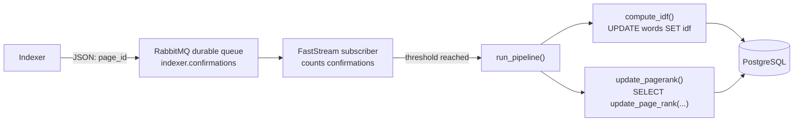

# Ranking service

The ranking service maintains the two scores Boogle uses to order search results: inverse document frequency in `words.idf` and page importance in `page_rank.score`. It is a passive follower of the indexer — it does not crawl, index, or decide when the corpus is "ready". Scoring runs once at startup and then after a configured number of index confirmations arrive from RabbitMQ.

Sources of truth for this section: `services/ranking/src/` and `migration/`.

!!! warning "IDF only — not TF-IDF"
    This service computes **IDF only**. `page_word.tf` is never read, and `words.doc_frequency` is never written by the scoring statement. Any TF-IDF combination belongs to a downstream consumer, not this service.

## Responsibilities

- Count index confirmations and trigger a full scoring pass at a threshold (default `100`).
- Recompute IDF for every word present in `page_word` with a single SQL `UPDATE`.
- Recompute PageRank over **indexed** pages with a PL/pgSQL function.
- Own the `page_rank` table; leave crawl and index tables untouched.
- Fail closed on misconfiguration at startup and emit structured JSON logs.

## Flow at a glance



## Runtime facts

| Fact | Implemented value |
|---|---|
| Entry point | `services/ranking/src/main.py` (`main()` → `asyncio.run(service.start())`) |
| Async framework | `asyncio` + FastStream 0.7.7 (RabbitMQ) |
| Database | `psycopg` 3 + `psycopg_pool`; async pool of 2–10 connections |
| Python | **3.11+ required** (`asyncio.TaskGroup`); container builds on 3.12 |
| Scheduler | None. Startup run plus confirmation threshold only |
| Logging | JSON to stdout; optional `LOG_PATH` adds a file sink |
| Trigger sources | Startup (`RANKING_RUN_ON_STARTUP`, default enabled) and confirmations |

!!! note "No wall-clock scheduler"
    `APScheduler` appears in `services/ranking/requirements.txt` but is not imported by any file in `services/ranking/src/`. There is no periodic timer in this service. `RANKING_SCHEDULE_INTERVAL` has no effect.

## Triggering and failure behavior

The subscriber counts confirmations; it does not validate their payload beyond reading `page_id` for logging. When the counter reaches the threshold, a locked runner snapshots the batch, runs the pipeline, and subtracts only that snapshot, so confirmations arriving mid-run count toward the next pass. A failed run leaves its batch pending until **another confirmation** arrives — there is no automatic retry loop. IDF and PageRank run concurrently but **commit independently**; a sibling failure cancels the other task but cannot undo a stage that already committed.

See [Architecture](architecture.md) for the lifecycle and locking details.

## Data ownership

| Table | IDF stage | PageRank stage | Notes |
|---|---|---|---|
| `words` | writes `idf` | — | `doc_frequency` is not updated |
| `page_word` | reads `word_id`, distinct `page_id` | — | `tf` is ignored |
| `pages` | reads `COUNT(*)` of **all** pages | reads `indexed`, `url_id` of **indexed** pages | never written here |
| `graph_edges` | — | reads `from_url`, `to_url` | restricted to indexed → indexed |
| `page_rank` | — | deletes stale rows, upserts scores | owned by this service |
| `urls` | — | referenced through foreign keys | never written here |

!!! warning "Corpus sizes differ"
    IDF's `N` counts **all rows in `pages`**, whereas PageRank's `N` counts only rows with `indexed = TRUE`. See [Algorithms](algorithms.md).

## Verified commands

Run from `services/ranking/` (definitions in `services/ranking/justfile`):

```bash
just run              # venv/bin/python src/main.py
just test             # unit tests only
just test-cov         # unit tests with coverage report
just test-integration # recreates the isolated boogle_test DB, then runs integration tests
```

`just test-integration` applies every `migration/*.sql` file to `boogle_test` and never touches the live `boogle` database. Integration tests skip themselves when no PostgreSQL is reachable.

## Documentation map

- [Architecture](architecture.md) — startup, messaging, concurrency, failure handling.
- [Algorithms](algorithms.md) — what the two scoring passes actually compute.
- [Database functions](database-functions.md) — SQL contracts, table access, transaction behavior.
- [Configuration](configuration.md) — environment variables, validation, runtime and test setup.
