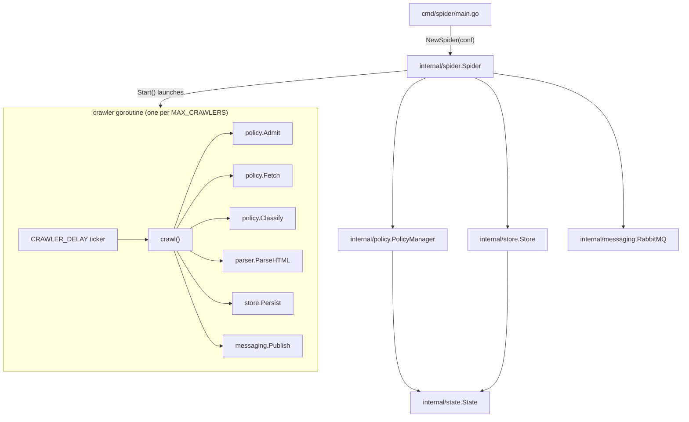
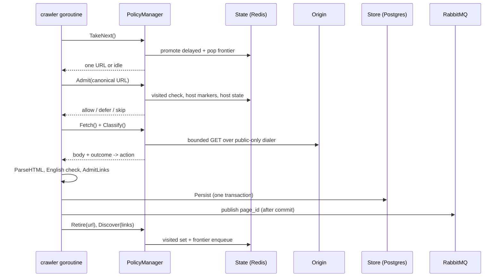

# Spider architecture

**Last updated:** 2026-11-23

This page maps the spider's components and the state it owns. Behavioral detail
is in [Implementation](implementation.md); environment knobs are in
[Configuration](configuration.md).

## Component map



| Module | Responsibility | Key source |
|---|---|---|
| `cmd/spider` | Load config, construct spider, hard-coded seed list, signals | `services/spider/cmd/spider/main.go` |
| `internal/spider` | Worker goroutines, crawl cycle, retry/park/requeue, AMQP channel pool | `services/spider/internal/spider/spider.go` |
| `internal/policy` | Admission, robots/host state, fetch, classification, discovery, backoff | `services/spider/internal/policy/*.go` |
| `internal/state` | Frontier, visited set, URL/host state, markers; Redis and in-memory implementations | `services/spider/internal/state/state.go`, `redis.go`, `memstate.go` |
| `internal/store` | Redis client, PostgreSQL client, transactional page persistence | `services/spider/internal/store/{cache,db,store}.go` |
| `internal/parser` | HTML metadata/links/text, language detection, sitemap URL extraction | `services/spider/internal/parser/*.go` |
| `internal/messaging` | Durable queue declaration, confirmed publishing, per-channel confirms | `services/spider/internal/messaging/rabbitmq.go` |
| `internal/utils` | Canonicalization, public-only dialer, bounded GET, set and logger helpers | `services/spider/internal/utils/*.go` |
| `internal/config`, `internal/entity` | Env-only config and the `Page` value written to storage | `services/spider/internal/config/config.go`, `internal/entity/entity.go` |

`PolicyManager` owns decisions but not persistence: it is constructed over a
`state.State`, which has both a Redis implementation (production) and a memory
implementation (tests). The `With*` methods copy the manager value, so a caller
can substitute a clock, fetcher or robots fetcher without mutating the original.

## Redis: crawl state

The client is go-redis v9 (`services/spider/internal/store/cache.go`), default DB
1. All keys carry a `{...}` hash tag so multi-key Lua scripts remain legal if
the cache is ever clustered (`services/spider/internal/state/redis.go`).

| Key | Type | Purpose |
|---|---|---|
| `{prefix:frontier}` | sorted set | URLs waiting to be crawled |
| `{prefix:delayed}` | sorted set | Parked URLs, scored by due Unix time |
| `{prefix:visited}` | set | Successfully retired canonical URLs |
| `{prefix:url:<sha1>}` | hash | Per-URL attempts, last status/error, enqueue time |
| `{prefix:host:<host>}` | hash | Robots-derived and counter fields for a host |
| `{prefix:host:<host>}:{dead,cold,cooldown}` | TTL keys | Host markers |
| `{prefix:stats:<host>}` | hash | Refusal reason counts |

`prefix` is `SPIDER_REDIS_PREFIX` (default `boogle:spider`). Host hash fields are
`crawl_delay_ms`, `max_pages`, `pages_crawled`, `window_started_at`,
`consec_failures`, `status`, `robots_at`, `first_seen`, `last_success`, `allow`,
`disallow`, `sitemaps`, `sitemaps_claimed_at`. URL hash fields are `attempts`,
`last_status`, `last_error`, `enqueued_at`, `url`.

Atomic multi-key operations run as Lua scripts: success recording, sitemap
claiming, frontier popping and delayed promotion
(`services/spider/internal/state/redis.go`). A TTL is applied to URL state in
`BumpAttempts`; the `visited` set itself has no TTL or removal in the current
source.

### Host markers

| Marker | Set when | Effect in `hostGate` |
|---|---|---|
| `dead` | Unreachable host, DNS/connection/TLS failure, or a robots fetch error | `Skip` / `host_dead` until TTL |
| `cold` | Per-host page budget exhausted | `Skip` / `host_cold` until TTL |
| `cooldown` | Timeout, rate limit, server error, robots 429/5xx | `Defer` / `host_cooling_down` until TTL |

Markers are independent TTL keys, so a host may hold more than one at once.
They are checked before host state is read. Host status values are `ready` and
`degraded`.

## PostgreSQL: page storage

The DSN is assembled in `services/spider/internal/store/db.go` with
`sslmode=disable`. SQL is parameterized with `$n` placeholders; dynamic string
building only generates placeholder lists for batch inserts.

| Table | Spider writes | Relevant columns / behavior |
|---|---|---|
| `urls` | yes | `id UUID DEFAULT gen_random_uuid()`, `url TEXT UNIQUE NOT NULL`; upserted before pages and edges |
| `pages` | yes | `url_id UUID UNIQUE` FK, `html TEXT`, `metadata JSONB`; conflict on `url_id` updates metadata |
| `graph_edges` | yes | `from_url`, `to_url` UUID FKs, unique pair; `ON CONFLICT DO NOTHING`, self-links skipped |
| `words`, `page_word`, `page_rank`, `pages.indexed*` | no | Not in the spider's SQL layer |

Schema source: `migration/01_schema.sql`. The commented-out `urls.status`
column is not active.

`store.Persist` writes the page, its link URLs and its graph edges inside one
transaction. Link ids come back keyed by URL (`RETURNING id, url`), so edge
construction does not depend on row order.

## RabbitMQ: indexer job contract

The queue name resolves as `RABBITMQ_QUEUE` > `RABBITMQ_JOB_QUEUE` >
`indexer.jobs` (`services/spider/internal/config/config.go`). The spider
declares it durable at construction (`services/spider/internal/messaging/rabbitmq.go`).

Publishing uses mandatory mode, `application/json` content type, persistent
delivery mode, publisher confirms, a 5 s confirm wait, and explicit checks for
`basic.return` and nack. One AMQP channel is opened lazily per crawler id and
reused; a broken channel is dropped so the next round reopens one.

```json
{"page_id":"<pages.id UUID>"}
```

The payload is produced by `messaging.NewIndexerJobPayload(pageId.String())`
after persistence succeeds. `internal/messaging/type.go` also declares an
`IndexerJob` struct with the same `page_id` field, but the publish path uses the
payload constructor.

## Control and data flow



Robots discovery is a side path: `EnsureHost` caches parsed rules for
`ROBOTS_TTL_SEC`, records `Crawl-delay` and sitemap URLs, and attempts one
claim-based sitemap expansion per robots refresh. Sitemaps are expanded only as
`<url><loc>` entries; index files are not followed.

## Boundary and failure posture

- All HTTP egress goes through `utils.PublicOnlyDialContext`, which resolves the
  host and dials that exact IP. There is no proxy path.
- `MAX_BODY_BYTES` and `MAX_REDIRECTS` bound a fetch; unsupported redirect
  schemes are permanent failures.
- RabbitMQ, Redis and PostgreSQL failures at construction are process-fatal,
  not degradable: `NewSpider` calls `log.Fatal` for the broker, and the Redis
  and PostgreSQL clients call `log.Fatalf` on failed connect/ping.
- `LoadConfig` never returns an error, so bad tuning values are either silently
  defaulted (`getIntWithDefault`) or reported to stdout for second-based knobs
  (`secondsWithDefault`).

See [Known limitations / verified drift](implementation.md#known-limitations-verified-drift)
for the full list of code-verified gaps.
