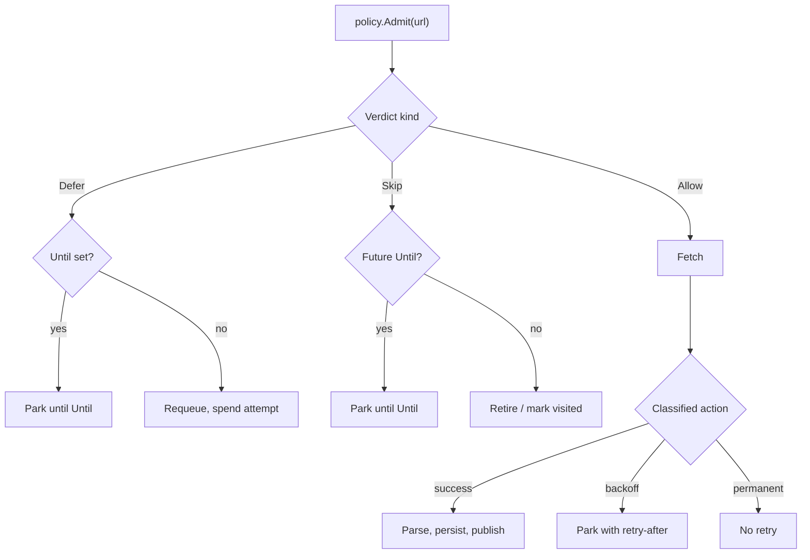

# Spider implementation

**Last updated:** 2026-11-23

This page describes what the code in `services/spider/` actually does: startup,
one crawl cycle, decision rules, failure handling, and code-verified caveats.

## Startup and shutdown

`main()` loads config with `conf, _ := config.LoadConfig()`, constructs the
spider, registers `SIGINT`/`SIGTERM`, starts `Spider.Start(seeds)` in a goroutine,
and blocks on the signal channel (`services/spider/cmd/spider/main.go`). The
discarded error slot is harmless today because `LoadConfig` always returns
`nil`, but the signature implies validation that does not exist.

`NewSpider` builds the HTTP client, logger, RabbitMQ connection, Redis client,
`RedisState`, `PolicyManager`, parser and store, then stores a cancellable root
context (`services/spider/internal/spider/spider.go`). The seed list is
hard-coded in `main.go` and is not configurable: four Wikipedia URLs plus
Wikidata, archive.org, github.com/trending, Stack Overflow, Hacker News,
MIT News, BBC News and Reuters.

`Start` calls `store.Init`, which enqueues the seeds only when the Redis frontier
is empty (`services/spider/internal/store/store.go`), then launches one worker
goroutine per `MAX_CRAWLERS`. Restarts therefore do not re-inject seeds.

On signal, `main` prints `Exiting gracefully` and calls `Stop`, which cancels the
root context and waits on the worker `WaitGroup`. The deferred `Close` closes
every per-crawler AMQP channel, then the store, broker connection and logger.
Cancellation is not called directly in `main.go`; it lives inside `Stop`.

!!! danger "Dependencies are fatal at construction"
    RabbitMQ (`log.Fatal` in `NewSpider`), Redis (`log.Fatalf` after `Ping`) and
    PostgreSQL (`log.Fatalf` on `sql.Open`/`Ping`) are hard requirements. A
    missing datastore exits PID 1 rather than entering a degraded mode.

## One crawl cycle

Each worker runs a ticker with period `CRAWLER_DELAY` **milliseconds** and wraps
each cycle in a `CRAWLER_TIMEOUT` **seconds** deadline. A buffered
`fetchpool` channel of capacity `MAX_CONCURRENT_FETCH` is the only concurrency
gate; work itself comes from Redis.

| # | Step | Behavior on failure |
|---|---|---|
| 1 | Acquire a fetch slot | If the deadline expires first, return without popping a URL |
| 2 | `policy.TakeNext` | Promote due delayed URLs, then pop one frontier entry; errors skip the round |
| 3 | Canonicalize the popped URL | If invalid, the original spelling is used |
| 4 | `policy.Admit` | Error → `requeue` (see failure matrix) |
| 5 | `policy.Fetch` with the public-only client | Outcome passed to classification |
| 6 | `policy.Classify` | Error → `requeue`; non-success action ends the round |
| 7 | `parser.ParseHTML`, English-only check | Unparseable or non-English → `Discard` |
| 8 | `policy.AdmitLinks` | Refused links are counted by reason, not enqueued |
| 9 | `store.Persist` | Error or nil id → `requeue` |
| 10 | Publish `page_id` | Error → drop AMQP channel, park URL for 30 s without spending an attempt |
| 11 | `Retire` and `Discover` | Errors are logged; the page is already stored and published |

Bookkeeping after a timed-out or slow fetch uses `bookkeepingContext`:
`context.WithoutCancel` with a fresh 5 s timeout, so parks, retires and
discoveries are not cancelled with the crawl deadline.

### Decision rules



`Verdict.Kind` and `Action.Kind` use `Allow` and `ActSuccess` as zero values: an
unset field fails open, so callers must set them explicitly.

Admission gates run cheapest-first in `services/spider/internal/policy/admit.go`:
URL shape and scheme, canonicalization, visited set, host markers, robots
freshness (`EnsureHost`), rolling per-host page window and budget, then robots
rules and local path/extension/language rules. Every refusal is counted against
the host's stats hash.

Fetch outcomes are classified in `services/spider/internal/policy/classify.go`:

| Outcome | Action |
|---|---|
| 2xx with acceptable content type and body within `MAX_BODY_BYTES`; 304 | success |
| Truncated 2xx body | backoff / `truncated_body` |
| 429, 5xx, unknown status, unrecognized transport error | backoff |
| 400/405/451, 401, 403, 404, 410, other 4xx, redirect loop, unsupported redirect scheme, oversized body, unacceptable content type | permanent |
| Backoff when `attempts + 1 >= URL_MAX_ATTEMPTS` | permanent / `attempts_exhausted` |

A permanent or backoff action is recorded by the policy layer, including host
markers for DNS/connection/TLS (dead) and timeout/rate-limit/server errors
(cooldown). Cooldown TTL is derived from `HostCooldownBase` and, when larger,
the host's stored `Crawl-delay`.

### Failure handling matrix

| Failure | Recovery | Attempt budget |
|---|---|---|
| Fetch slot deadline | No URL popped | Unchanged |
| `Admit` error, classify error, persist failure, unknown verdict | `requeue`: `BumpAttempts`, retire at `URL_MAX_ATTEMPTS`, otherwise park with URL backoff | Spent |
| Defer with no `Until` | `requeue` | Spent |
| Skip with future `Until` | `Park` until that time | Unchanged |
| Skip without future `Until` | `Retire` | Ends the URL |
| Publish error | Drop the crawler's AMQP channel, `deferCrawl` parks for 30 s | Not spent — broker outage is not the URL's fault |
| Unparseable body / non-English page | `Discard` with `body_unparseable` / `language_not_english` | Ends the URL |
| `Retire`/`Discover` error | Logged only | Ends the URL |

`PopFrontier` removes the entry unconditionally; there is no in-flight state or
visibility timeout. The explicit `requeue`/`deferCrawl` calls above are the only
recovery for work lost after a pop.

## Persistence and publishing

`store.Persist` opens one transaction for three writes
(`services/spider/internal/store/store.go`, `services/spider/internal/store/db.go`):

```sql
-- 1. upsert the fetched URL
WITH ins AS (
    INSERT INTO urls(url) VALUES ($1)
    ON CONFLICT (url) DO NOTHING
    RETURNING id
)
SELECT id FROM ins
UNION ALL SELECT id FROM urls WHERE url = $1
LIMIT 1;

-- 2. upsert the page (conflict updates metadata only)
INSERT INTO pages(url_id, html, metadata) VALUES ($1, $2, $3)
ON CONFLICT (url_id) DO UPDATE SET metadata = EXCLUDED.metadata
RETURNING id;

-- 3. batch insert edges, keyed by URL rather than row position
INSERT INTO graph_edges (from_url, to_url) VALUES ($1, $2), ($3, $4)
ON CONFLICT DO NOTHING;
```

The transaction commits before any publish: a page is never announced unless
its database writes succeeded. Publishing waits for a broker confirm with a
5 s timeout, treats `basic.return` and nack as errors, and marks messages
persistent (`services/spider/internal/messaging/rabbitmq.go`).

## Identity, parsing and sitemaps

The fetched canonical URL is storage identity. Canonicalization happens once per
pop so fetch, persist and retire use the same spelling
(`services/spider/internal/spider/spider.go`). `og:url` is kept in metadata only
when it is same-host (`services/spider/internal/parser/html.go`), and
`entity.Page.URL` is explicitly the fetched URL
(`services/spider/internal/entity/entity.go`).

HTML parsing extracts links and images (canonicalized and de-duplicated),
metadata, a description capped at 300 characters, and document language.
Discovered links are re-admitted before being stored or enqueued.

Sitemap support is limited to `robots.txt` `Sitemap:` URLs. One expansion is
claimed per robots refresh via `ClaimSiteMaps`, and
`parser.FetchSitemaps` reads `<url><loc>` entries, resolves relative URLs
against the host and canonicalizes them (`services/spider/internal/parser/sitemap.go`).
Fetch errors are skipped. Sitemap index files are not supported, and the
`u.Parse` entry method is an explicit stub that returns an error.

## Verification

Verified in this environment: `go test ./internal/... -count=1` (all unit
packages pass), `go vet ./...` (exit 0), Go `1.27.4-X:nodwarf5` against a
`go 1.27` module. `staticcheck` is not installed; `golangci-lint` is installed
but was not run in that pass. Integration suites use the `integration` build tag
and need live datastores (`services/spider/justfile`).

An earlier project review recorded policy 78.7%, spider 59.6%, store 20.0% and
messaging 0% coverage; these figures were not re-measured in the verification
pass.

## Known limitations / verified drift

All items below were checked against the current source.

| Gap | Code-verified evidence | Consequence |
|---|---|---|
| **robots.txt status handling may mark hosts dead** (review H-01, 2026-11-22) | `robotsFetcherFrom` in `services/spider/internal/policy/hosts.go` turns every status other than 200, 429 or >=500 into an error; `EnsureHost` sends any fetch error to `markHostUnreachable`, which sets `MarkerDead` for non-timeouts; `hostGate` returns `Skip`/`host_dead` for that host. The review's contradicting test uses a fake fetcher that never applies the production conversion. | A 204/4xx on `/robots.txt` can blacklist a host for `DeadHostTTL`, skipping all its URLs. **Confirmed current, not fixed.** |
| Per-host `Crawl-delay` parsed but not used for pacing | Stored in `crawl_delay_ms` after flooring at `MinCrawlDelay` (`hosts.go`); its only observed non-test consumer is cooldown TTL (`classify.go`). The only pacing is the global `CRAWLER_DELAY` ticker (`spider.go`). | No per-host politeness delay. |
| `RABBITMQ_PROTOCOL` ignored | Read in `config.go` but the AMQP URI is hard-coded `amqp://` in `messaging/rabbitmq.go`. | `amqps`/custom schemes have no effect. |
| `REDIS_DELAY` unread | Exported by `entrypoint.sh` and present in both `.env.example` files, but no Go source reads it. | Changing it has no effect. |
| Sitemap indexes unsupported | `parser/sitemap.go` unmarshals only `<url><loc>`; `<sitemapindex>` entries are ignored and `u.Parse` is a stub. | Sitemap-only discovery misses nested sitemaps. |
| Destructive frontier pops | `PopFrontier` removes the entry (`policy/crawl.go`); recovery is the explicit `requeue`/`deferCrawl` paths in `spider.go`. | A crash between pop and bookkeeping loses work; no in-flight or visibility-timeout model. |
| Fatal-on-startup dependencies | `log.Fatal` / `log.Fatalf` in `spider.go`, `store/cache.go`, `store/db.go`. | Broker, Redis or Postgres outage exits PID 1. |
| `LoadConfig` cannot fail | Always returns `nil` error (`config.go`) while `main.go` discards the error slot. | Misconfiguration is detected only when a constructor fails. |
| URL-state TTL coverage | URL hashes expire via `BumpAttempts` (`state/redis.go`); no `Expire`/`SRem` on the `visited` set was observed. | Other URL-state writes and the visited set lack that expiry path. |

### Previously reported gaps verified fixed

| Older finding | Current evidence |
|---|---|
| `og:url` could become storage identity | Fetched-URL identity plus same-host-only metadata; regression tests in `internal/parser/parser_test.go` |
| Queue name drift (`indexer.job` vs `indexer.jobs`) | `jobQueueName()` defaults to `indexer.jobs`; asserted in `internal/config/config_test.go` |
| Env examples could not start the spider | RabbitMQ section added to `services/spider/.env.example` and root `.env.example`; `entrypoint.sh` matches |
| Credentials printed at startup | `Secret` type with redacting formatters and `Redacted()`; safe startup log |
| No SSRF or redirect filtering | Public-only dialer, bounded redirects, unsupported-scheme rejection |
| Transient publishes / no confirms | Mandatory, persistent, confirmed publishing with return/nack checks |
| Unordered graph-edge construction | `RETURNING id, url` and URL-keyed id mapping |
