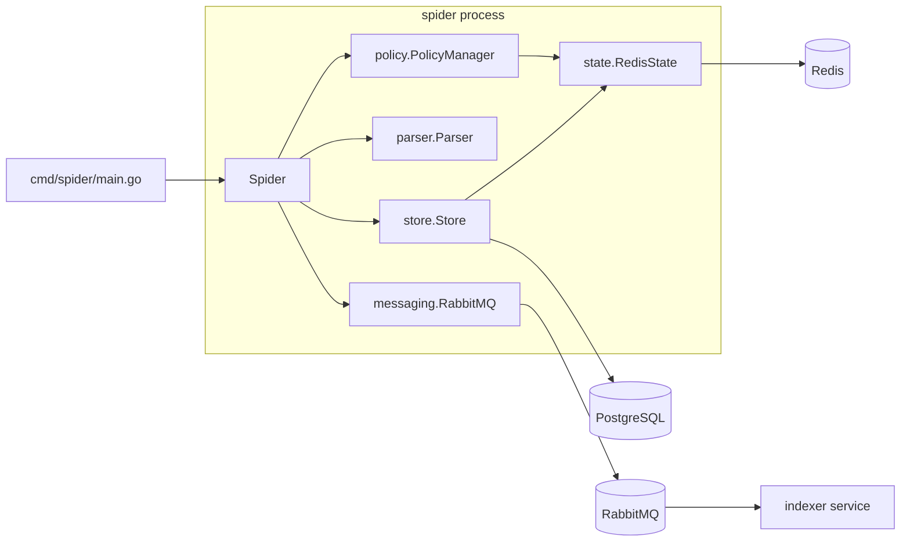

# Spider service

**Last updated:** 2026-11-23  
**Source of truth:** `services/spider/` and `migration/01_schema.sql`

The Spider is Boogle's Go crawler. It pulls URLs from a Redis-backed frontier,
applies URL and host policy, fetches public web pages, writes pages and link
graph edges to PostgreSQL, and publishes a page id to RabbitMQ for the indexer.
It does not build the index, rank results, or serve queries.

!!! note "Scope of these pages"
    These pages describe the current tree. Older `docs/SPIDER.md` and
    `services/spider/README.md` contain stale statements about the Go version,
    environment variable names, the frontier source and sitemap support. The
    [known limitations section](implementation.md#known-limitations-verified-drift)
    records the verified gaps and fixes.

## At a glance

| Property | Value | Source |
|---|---|---|
| Language / toolchain | Go; `go.mod` declares `go 1.27` | `services/spider/go.mod` |
| Entry point | `cmd/spider/main.go` | `services/spider/cmd/spider/main.go` |
| Work model | `MAX_CRAWLERS` goroutines, each with a ticker; one shared `fetchpool` semaphore | `services/spider/internal/spider/spider.go` |
| Work source | Redis frontier, not a database queue | `services/spider/internal/policy/crawl.go` |
| Durable crawl state | Redis via `state.RedisState` | `services/spider/internal/state/redis.go` |
| Page storage | PostgreSQL (`urls`, `pages`, `graph_edges`) | `services/spider/internal/store/db.go` |
| Output | `indexer.jobs` messages carrying a page UUID | `services/spider/internal/messaging/type.go` |
| Seeds | Twelve hard-coded URLs in `main.go` | `services/spider/cmd/spider/main.go` |

## Role in the system



The broker message is the spider's handoff to the indexer. The spider writes `html` and
`metadata` on `pages` plus the outgoing `graph_edges`, then sends the persisted
page UUID. Its SQL layer contains inserts only for `urls`, `pages` and
`graph_edges` (`services/spider/internal/store/db.go`); `words`, `page_word`,
`page_rank` and the `pages.indexed*` columns are outside this service's write
path.

## Lifecycle at a glance

1. `main` loads environment configuration, constructs the spider, registers
   `SIGINT`/`SIGTERM`, and starts the workers.
2. `store.Init` seeds the Redis frontier only when it is empty, so restarts do
   not re-inject the seed list.
3. Each worker pops one URL per tick, asks policy for a verdict, fetches,
   classifies, parses, persists, publishes, and records bookkeeping.
4. On a signal, `Stop` cancels the root context and waits for workers; the
   deferred `Close` drains AMQP channels and closes the stores and logger.

The [implementation page](implementation.md) covers each step and the failure
matrix; the [configuration page](configuration.md) lists every environment
variable and its default.

## Data ownership

| Store | Spider owns | Notes |
|---|---|---|
| Redis | Frontier sorted set, delayed set, visited set, per-URL attempt state, per-host state, host markers, refusal stats | Shared connection pool between `store.Store` and `state.RedisState`; default key prefix `boogle:spider` |
| PostgreSQL | Rows in `urls`, `pages` and `graph_edges` | One transaction per page; `sslmode=disable` in the DSN |
| RabbitMQ | Publications to the configured indexer queue | Queue declared durable; publishing uses mandatory mode and confirms |
| HTTP client | Public-only egress | Non-public addresses rejected by the dialer; no proxy support |

See [Architecture](architecture.md) for the keyspace, table and message details.

## Contracts

The message body is a JSON object with the persisted page id. It is published
only after the database transaction commits:

```json
{"page_id":"<pages.id UUID>"}
```

`RABBITMQ_QUEUE` takes precedence over `RABBITMQ_JOB_QUEUE`; both default to
`indexer.jobs`, matching the indexer's configured queue. The queue name is
resolved in `services/spider/internal/config/config.go`.

Storage identity is the canonical form of the **fetched** URL. A document's
`og:url` is retained only when it is same-host and is metadata only, never the
row identity (`services/spider/internal/entity/entity.go`,
`services/spider/internal/parser/html.go`).

## Trust boundary

The HTTP client resolves each host and dials the resolved public IP, rejecting
loopback, private, link-local, CGNAT, metadata and other non-public ranges
(`services/spider/internal/utils/netguard.go`). Redirects are followed up to
`MAX_REDIRECTS` (default 10); a redirect to a scheme other than HTTP(S) is an
explicit error and is classified as permanent. Robots requests use the same
client and a 1 MiB body cap.

## Operating and verifying

Commands below are the service-local recipes in `services/spider/justfile` and
the Go commands recorded for this service:

```bash
just dev                                   # go run ./cmd/spider/main.go
just test                                  # go test ./internal/... -count=1
just test-integration                      # go test -tags integration ./internal/... -count=1
just test-cov                              # coverage profile plus per-function report
just lint                                  # golangci-lint run ./...
go vet ./...
```

Integration tests need live PostgreSQL, Redis and RabbitMQ; the default unit
suite does not.

## Next

- [Architecture](architecture.md) — components, state model and contracts.
- [Implementation](implementation.md) — crawl cycle, failure handling, caveats.
- [Configuration](configuration.md) — environment variables, defaults, dead knobs.
